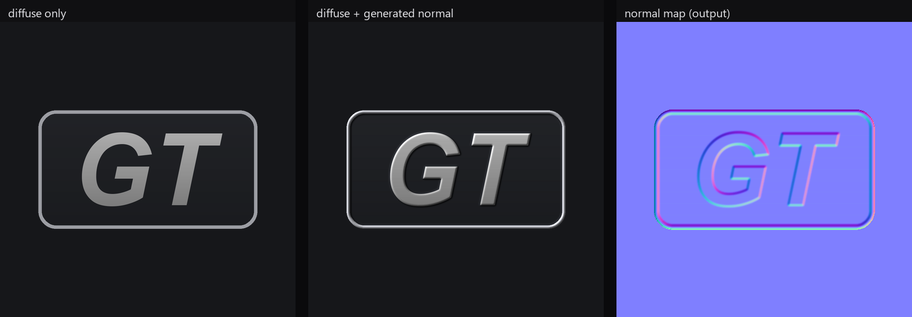

# gtatools

[](https://github.com/wokken198/gtav-toolkit/actions/workflows/tests.yml)

Small, focused helpers for GTA V (Enhanced / gen9) texture and ped-variation work. Four commands, one CLI:

| command | what it does |
|---|---|
| `gtatools normals` | badge diffuse map → tangent-space normal map (DDS) + contact sheet |
| `gtatools audit` | CPedVariationInfo (`.ymt`) consistency check against vanilla's rules |
| `gtatools scale` | DDS rescaling that keeps pixel format and mip depth |
| `gtatools pack` | build a YTD from a CodeWalker XML + a folder of DDS |

No game assets are included; everything reads from your own install.



## Install

```bash
pip install -e .
```

Python 3.9+, `numpy`, `Pillow`. Two optional dependencies, needed only by the commands that use them:

- **texconv.exe** (DirectXTex) — required by `normals` and `scale`; on `PATH`, in the working directory
  tree, or passed with `--texconv` / `GTA_TOOLS_TEXCONV`.
- **CodeWalker.Core.dll** (dev48+) plus Windows PowerShell — required by `pack`; located through
  `--core-dir`, `GTA_TOOLS_CW`, or the common-install probe described below.

## normals

```bash
gtatools normals <src> --out out --sheet sheet.png
# defaults: --strength 6.5 --blur 1.2 --fmt DXT5 --max-mips 12
```

For every `*badge*.dds` that is not already a normal map:

1. decode with texconv → RGBA
2. height = `0.7 * percentile-normalised luma + 0.3 * alpha`, then Gaussian blur (`--blur`)
3. gradient → normal, slope scaled by `--strength`
4. margin (alpha ≈ 0) forced to `(128,128,255)` — otherwise the atlas cell border keeps a slope and
   shows up as a faint rectangle around the engraving
5. encode with a full mip chain (`--max-mips` caps it)

Tuning: flat decals 8–10, chrome / baked-specular art 4–5, text-only art 6–7.


## audit

```bash
gtatools audit ped.ymt.xml --json report.json
```

Checks against what vanilla peds actually do:

- `numAvailTex(component) == sum(aTexData)` over that component's drawables
- `compInfos` has exactly one entry per `(slot, drawable)`; the key is the **slot index inside
  `availComp`**, not the component's position in `aComponentData3`
- `texId` is a race suffix (`0 uni, 1 whi, 2 bla, 3 chi, 4 lat, 5 ara, 10 pak`), not a texture slot
- dangling components (declared in the ymt but with no drawable in the ydd) and count mismatches

Exit code `2` when problems are found, so it can gate a build.

## scale

```bash
gtatools scale <paths...> --out resized --long-edge 1536 --min-edge 1025
# --min-edge skips anything whose long edge is already <= that value
```

- decodes with texconv, resizes RGB and alpha **separately** — Pillow's RGBA Lanczos premultiplies
  alpha and darkens semi-transparent art — then re-encodes in the original format
- target size is rounded to a multiple of 4; mip count is preserved but capped to the new chain
- unsupported formats are skipped and reported, never half-written
- an output tree mirroring the inputs is built under `--out`

## Pack

```bash
gtatools pack --xml vehshare.ytd.xml --build build_dir --out vehshare.ytd \
              --original vanilla_vehshare.ytd
```

`--original` copies `G9_UsageData / G9_Flags / UsageData / UsageFlags / ExtraFlags` from an existing
archive, matched by texture name. This matters: CodeWalker's YTD XML does not carry the gen9
render-target descriptor bits, and losing them breaks scripted render targets (dashboard dials and
similar) — the archive still loads, the game crashes when the target is drawn.

`--legacy` writes gen9=off (version 165 assets). `--core-dir` overrides the CodeWalker location; when
it is omitted the CLI probes `GTA_TOOLS_CW`, `CODEWALKER_DIR`, common install paths, and the working
directory's parents.

## Use it as a DeepSeek Harness plugin

`dsh-plugin/` is an installable DSH bundle that exposes the same four operations as agent tools
(`gta_badge_normal`, `gta_ymt_audit`, `gta_ytd_scale`, `gta_ytd_pack`). The Python package is vendored
inside, so nothing needs to be pip-installed.

### Install from a checkout

```bash
git clone https://github.com/wokken198/gtav-toolkit
```

Then in DeepSeek Harness: **Plugins → Add plugin**, and point it at `gtav-toolkit/dsh-plugin`.
The bundle is named `dsh-gta-tools`.

### Install from a pinned commit

Pass this as the `target` of `install_bundle`, replacing `<commit>` with a commit of this repository:

```text
git+https://github.com/wokken198/gtav-toolkit.git#<commit>&path:/dsh-plugin
```

### Install from npm (only if you publish it yourself)

```bash
cd dsh-plugin
npm publish          # or: npm publish --access public  for a scoped name
```

Users then install `dsh-gta-tools@<version>`.

There is no central store to submit to: the DSH plugin market only reads index URLs a user adds under
Settings, so a checkout, a pinned commit, or an npm package is the distribution channel.

Environment variables (optional; set before launching DSH):

| variable | meaning |
|---|---|
| `GTA_TOOLS_PYTHON` | python executable; when unset the plugin probes `python3`, `python`, then the Python bundled with DeepSeek Harness |
| `GTA_TOOLS_TEXCONV` | path to `texconv.exe`; when unset it is looked up on `PATH` and in the working directory's parents |
| `GTA_TOOLS_CW` | CodeWalker folder holding `CodeWalker.Core.dll`; when unset the plugin probes `GTA_TOOLS_CW`/`CODEWALKER_DIR`, common install locations, Desktop, and the working directory's parents. Only `gta_ytd_pack` needs it |

Node and CodeWalker are not bundled: `pack` shells out to CodeWalker's .NET assembly on Windows.

## Known pitfalls this repo encodes

- **XML → YTD is lossy** for `script_rt_*` textures; always pack with `--original` when you have a
  reference archive.
- **CodeWalker's DDS export flattens A8R8G8B8 to 8 bpp grayscale**, so exported channel statistics lie
  for mask-style textures (plate fonts, glyph atlases); read `TextureData.FullData` if it matters.
- **Legacy (gen8) vertex data** is exported as `<Data2>` while the importer only reads `<Data>` —
  round-tripping a legacy `.ydd` through XML silently drops its meshes. Merge legacy peds from binary.
- `availComp` appears either as spaced decimals or one hex blob; both forms are parsed here.
- Patch-DLC override order follows `dlclist.xml`, not the `<order>` element in `setup2.xml`: a texture
  shipped in a later-loading pack wins even when an earlier pack declares the same name.
- Pillow ≥12 premultiplies alpha when resizing RGBA, which darkens translucent art: scale channels
  separately.

## Tests

```bash
python -m unittest discover -s tests -v
```

11 tests, covering DDS header parsing (DXT5 / DX10 BC7 / A8R8G8B8 / rejection), the normal-map maths
(flat in → flat out, margin flattening, luma direction) and the ymt audit rules (consistent, wrong
`numAvailTex`, missing `compInfo`, hex `availComp`).

## Layout

```
src/gtatools/       cli.py, dds.py, normals.py, ymt.py, cw.py
tests/              test_core.py
resources/          pack_ytd.ps1
dsh-plugin/         DSH bundle (index.js, locale/, vendor/gtatools, icon.svg)
```

## License

MIT for the code. Game-derived assets are not covered and are not shipped here.
