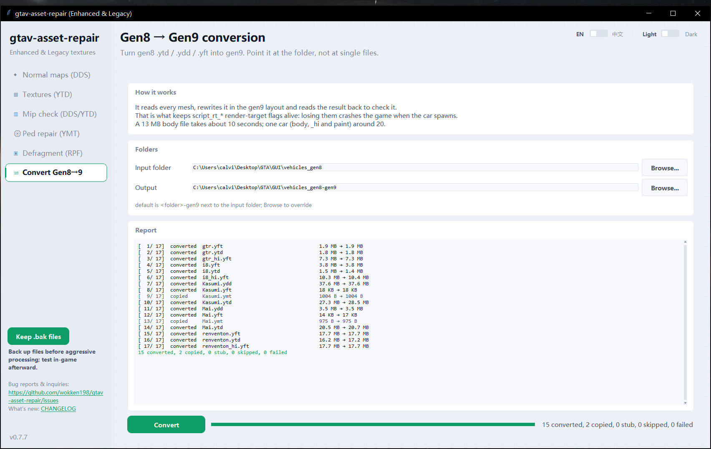
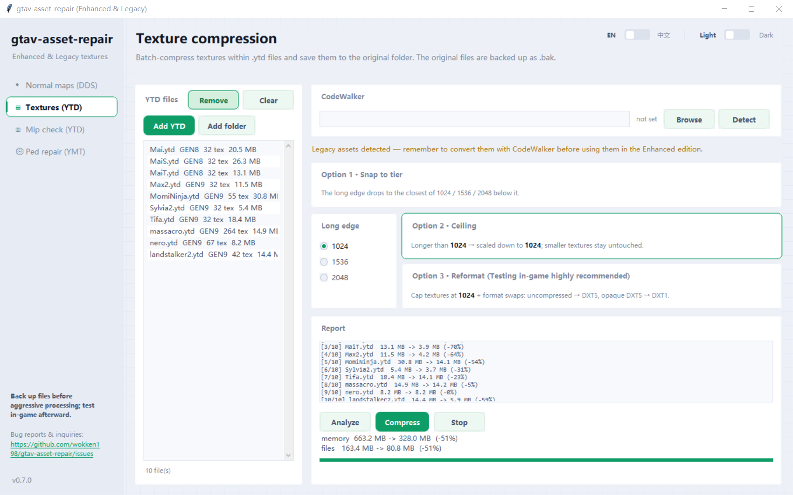
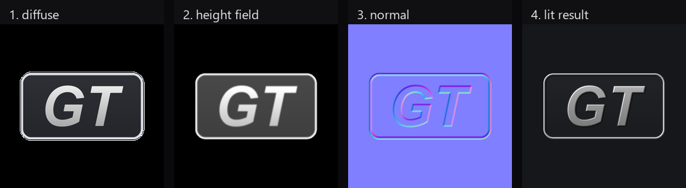

# gtav-asset-repair

> **A note from the author:** I put this together in a week, building one feature a day. I'm stopping
> feature development for now, unless a breaking issue comes up.
>
> If this tool helped you out, a link back to
> <https://github.com/wokken198/gtav-asset-repair> would be much appreciated. The license requires you
> retain the copyright notice; linking back is just a kind gesture, not required.

**Enhanced & Legacy** workbench for GTA V — **convert Legacy `.ytd` / `.ydd` / `.yft` into the gen9
layout inside the GUI**, find and fill short mip chains, shrink `.ytd` archives without breaking them,
audit `.ymt` ↔ `.ydd` pairs, and build badge normal maps. Desktop app, CLI, and a DeepSeek Harness
bundle. No CodeWalker, no external converter, no external texture tool.

[](https://github.com/wokken198/gtav-asset-repair/actions/workflows/tests.yml)
[](https://github.com/wokken198/gtav-asset-repair/releases/latest)


**[Download the portable build](https://github.com/wokken198/gtav-asset-repair/releases/latest)** — unzip,
run `gtav-asset-repair.exe`. No Python needed. `texconv.exe` is bundled, and nothing else has to be
installed: reading, compressing, MIP repair, ped repair and RPF defragging all run on the bundled readers.

## What it does

| page | job |
|---|---|
| **Normal maps (DDS)** | badge diffuse → tangent-space normal map, with strength / blur / alpha weight |
| **Textures (YTD)** | shrink the textures inside a `.ytd`, keep a `.bak` |
| **Mip check (YTD/DDS)** | report short mip chains, then rebuild the archive with full ones |
| **Ped repair (YMT)** | check `.ymt` against its `.ydd`, correct the drift |
| **Defrag (RPF)** | rewrite an `.rpf` so its payload is contiguous again, reclaiming the space left by replaced files |
| **Convert Gen8→9** | rebuild Legacy `.ytd` / `.ydd` / `.yft` in the gen9 layout, copy `.ymt` / `.yld` unchanged |



Compression only frees memory; the archive on disk keeps its old size until it is defragged, which is what
the **Defrag (RPF)** button and `rpf defrag` do: they read the archive, lay the payload out contiguously,
and rewrite the directory. Child archives are rebuilt too, but only when every entry inside them can be
read — a child that ships encrypted entries is left byte-for-byte alone, because moving it would break the
game. The report says how many children were skipped for that reason.

`Analyze` and `mip check` read only the RSC7 header, which is why you can size up a pack in a second
without touching a single file.


## Why it rewrites instead of patching

`gen8to9` is the only part of this project that converts assets. CodeWalker's Asset Converter and
Cfx's Alchemist patch bytes in place — fast, and fine for what they preserve. This tool decodes every
field, rebuilds it in the gen9 layout and compares the result against its source, which costs about
eight seconds on a 13 MB fragment and catches three things a patcher cannot:

| | CodeWalker | Alchemist | this tool |
|---|---|---|---|
| `script_rt_*` render-target flag | lost (`0`) | rewritten (`0x40010`) | kept as authored (`0x1010000`) |
| fragment runtime class VFTs | left on the legacy table | left as authored | switched to gen9 |
| gen9 material defaults | zeroed | partial | filled from the gen9 definitions |

The first row is not cosmetic. A `.ytd` that carries a dashboard render target and loses its flag
crashes the game the instant the car spawns — no texture shows, no error logged, the pack simply
does not load. It took a day of bisecting to find, and the fix is one line once you know the field
is load-bearing. A patcher reading that file as bytes has no reason to look at it.

Rewriting costs speed and buys two things a patcher cannot offer:

- **Every output field can be compared against its source.** `gtav-asset-repair gen8to9 --json`
  reports per-file results, and the test suite pins whole-file comparisons against retail gen9
  samples that ship with the game.
- **Nothing is written that the target format does not define.** Unknown legacy material
  parameters are dropped at write time instead of being carried into a format that will ignore
  them; the source files are never modified.

If you want the fastest possible conversion and only ever touch vanilla-shaped assets, a patcher
will do. If a pack comes from a third-party tool and misbehaves after conversion, the rewrite path
is what tells you *which* field was wrong instead of handing you a black box.

## Measured savings

Real packs, before → after, every write leaving a `.bak` behind:

| pass | before | after | delta |
|---|---|---|---|
| 10 ped/vehicle `.ytd` (3 Legacy + 7 Enhanced), capped to 1024 | 2092 MB VRAM | 758 MB VRAM | **−64%** |
| same run, file size | 155.2 MB | 70.4 MB | **−55%** |
| gen8 ped `.ytd`, 2048² textures capped to 1024 | 21.4 MB | 6.8 MB | **−68%** |
| 16-texture 2048² ped `.ytd`, rescaled to 1536 | 16.6 MB | 10.6 MB | **−36%** |
| 386 vehicles / 796 badge textures, rebuilt at 256 DXT5 with full mips | 65.4 MB | 44.1 MB | **−33%** |

Mip work goes the other way: a 4-file dictionary with 25 short chains went from `25 incomplete` to
`0 incomplete` in one pass, and two add-on peds were repaired, re-read and verified.

> **VRAM vs disk.** The VRAM numbers are yours the moment a file is rewritten. The *disk* numbers only
> become real after the archive holding those files is repacked — an `.rpf` keeps the old bytes as empty
> space until it is defragmented. The **Defrag (RPF)** page does that (OpenIV does the same thing), and
> it is the only place in this tool that rewrites an archive.

| Analyze — estimate only, nothing written | Compress — 9 written, 1 skipped |
|---|---|
|  |  |

## Install

**Windows, no Python:** download `gtav-asset-repair-0.7.7.zip` from the
[latest release](https://github.com/wokken198/gtav-asset-repair/releases/latest), unzip the **whole folder**
(the exe needs `_internal/` next to it) and run `gtav-asset-repair.exe`. If Windows SmartScreen blocks it
(a fresh build has no signature), run `Run.bat` instead — a batch file is not blocked.

**From source:**

```bash
pip install -e .
```

Python 3.11+, `numpy`, `Pillow`. One optional extra:

- **texconv.exe** (DirectXTex) — only `normals` and `scale` use it; on `PATH`, next to the exe, or pass
  `--texconv`. The portable build already ships it.

## Quick start

1. `Add folder` — point it at a folder of `.ytd` (or `.dds` for normal maps).
2. Pick the long-edge limit (`1024` is the usual sweet spot for vehicles).
3. `Analyze` → see VRAM and file savings before anything is written.
4. `Compress` → each dictionary is written as `<name>_lite.ytd` beside the source. Add `--inplace` on the CLI to rewrite in place and keep a `.bak`.
5. Launch the game and check the result. Anything that looks wrong: rename the `.bak` back.

The footer link and the note in the corner are there because step 5 is not optional for aggressive runs.

## CLI

Ten subcommands, all with the same `--json`, `--work` and error conventions:

| command | what it does |
|---|---|
| `gtav-asset-repair normals` | badge diffuse map → tangent-space normal map (DDS) + contact sheet |
| `gtav-asset-repair audit` | CPedVariationInfo (`.ymt`) check against vanilla's rules |
| `gtav-asset-repair scale` | DDS rescaling that keeps pixel format and mip depth |
| `gtav-asset-repair pack` | build a `.ytd` from a CodeWalker-style XML + a folder of DDS, restoring gen9 header bits from `--original` |
| `gtav-asset-repair ytd list` | read-only dump: name, size, format, mips per texture |
| `gtav-asset-repair mips check\|fix` | flag short mip chains, or rebuild the archive with full chains |
| `gtav-asset-repair lite` | shrink the textures inside `.ytd` files (cap / tier / agg) |
| `gtav-asset-repair ped check\|fix` | audit or repair `.ymt` ↔ `.ydd` pairs, keeping a `.bak` |
| `gtav-asset-repair rpf defrag` | rebuild an `.rpf` contiguously; `--dry-run` reports what it would reclaim |
| `gtav-asset-repair gen8to9` | upgrade a Legacy folder to Enhanced: `.ytd` re-headered, `.ydd` and `.yft` rebuilt for gen9, `.ymt`/`.yld` copied |

```bash
# normal map next to the source
gtav-asset-repair normals badge.dds --strength 4.5 --fmt DXT5

# what is inside an archive, and which chains are short
gtav-asset-repair ytd list car.ytd
gtav-asset-repair mips check car.ytd

# shrink a folder in place, originals kept as .bak
gtav-asset-repair lite "D:\mods\cars" --mode cap --cap 1024 --inplace

# ped audit, then repair (dry run first)
gtav-asset-repair ped check "D:\mods\peds"
gtav-asset-repair ped fix "D:\mods\peds" --apply
```

`--work DIR` anchors every default output below one folder; explicit `--out` still wins.
`mips check`, `mips fix` and `ped check` exit `2` when they find problems, so they can gate a build.

### Per-command notes

- **normals** — one diffuse map in, one `_n.dds` beside it. The defaults match vanilla badge intensity;
  raise `--strength` only if the result reads flat.
- **scale** — same format, same mip depth, just smaller. It never upscales.
- **pack** — rebuild a `.ytd` from XML + DDS. Pass `--original` with a reference archive so the gen9
  render-target bits survive; without them dashboard dials and similar scripted targets crash when drawn.
- **lite** — `cap` cuts anything longer than the limit, `tier` snaps to 1024/1536/2048, `agg` also swaps
  formats. `script_rt_*`, normal and spec maps keep their format, and nothing under 1024 px is touched.
- **ped check|fix** — `fix` is a dry run unless `--apply`, and it re-reads what it wrote.
- **gen8to9** — Legacy folder in, Enhanced folder out. `.ytd` gets a new header and the same pixels,
  and render-target textures (`script_rt_*`, dashboard dials) keep their flags — without them the game
  fails to create the render target and the car crashes the moment it spawns;
  `.ydd` is rebuilt at version 159 (new vertex declarations, gen9 material parameter set) while every
  mesh, channel and index stays identical to the source; `.yft` is rebuilt at version 171 against the
  gen9 runtime class tables, keeping every mesh channel, material, physics LOD, bound and glass pane;
  `.ymt`/`.yld` are copied byte for byte (their RSC7 version does not change).
  `--dry-run` prints the plan, the optional `dst` argument defaults to `<work>/gen9`, and every
  converted archive is read back and compared texture by texture (`.ytd`), mesh by mesh (`.ydd`) or
  fragment by fragment (`.yft`).
  Seven of the 18 vanilla vehicle dictionaries come out byte-identical to CodeWalker's own
  converter; the other eleven match semantically, differing only in where the converter happened to
  place its record table and in compactness. All 41 vanilla ped `.ydd` files come out
  channel-for-channel identical to the gen8 source and to CodeWalker's gen9 output. The 24 vanilla
  vehicle `.yft` files match the shipped gen9 fragments on all six runtime class VFTs and on the gen9
  material defaults — two areas CodeWalker's converter leaves untouched. Collision bounds are int16
  quantised in gen9, so their coordinates move by at most one quantisation step. Ped dictionaries whose
  drawables are plain `YdrDrawable` objects (third-party packs) keep their gen8 structural VFTs, because
  raising those to the gen9 table crashes such a ped in game; texture VFTs still move to gen9.
  Third-party packs with placeholder headers (resource state 0, junk class VFTs, a glass pane aimed
  at a non-glass mesh) are normalised to the retail gen9 values instead of being refused.
  There is no size gate. One crash used to look like a 32 MiB size wall — a large fragment failed in
  game through three different converters — but it was a dropped `script_rt_*` render-target flag,
  not the size: a 34 MB fragment (4160 pages of 8 KiB) loads fine once that flag is preserved.



Parameter maths, texture-format traps and the ped field rules: [docs/pitfalls.md](docs/pitfalls.md).

## Enhanced & Legacy

| area | Enhanced (gen9) | Legacy (gen8) |
|---|---|---|
| `normals`, `scale` (plain DDS) | yes | yes — DDS has no container version |
| `ytd list`, `mips check\|fix`, `lite` | yes | yes — detected from the RSC7 header |
| `pack` | version 5, default | version 13, pass `--legacy` |
| `ped check\|fix` | yes | yes — picked from the `.ydd` header |
| `gen8to9` | produces Enhanced from Legacy | yes — `.ytd` converted, `.ydd`/`.yft` rebuilt, `.ymt`/`.yld` copied |

**Both generations, one batch.** Every archive is read and written at its own RSC7 version (5 = Enhanced,
13 = Legacy), so a mixed pack stays mixed: no silent upgrade, no re-save into the wrong generation.

That does *not* mean a Legacy file becomes usable in the Enhanced edition on its own: `gen8to9` is the
explicit step that upgrades one. All four container types are handled — textures, drawables and
fragments are rebuilt, scripts and static collision copies are carried over — and anything it cannot
decode is reported as a skip with the original error text rather than written half-converted.

Archives are read and written by a **vendored fivefury** build (Unlicense) plus a self-contained RPF7
reader, so every page is pure Python and none of them need CodeWalker, OpenIV or .NET. The defrag page
rebuilds an archive directly; a child archive is only rewritten when every entry inside it can be read,
so archives that carry encrypted children are left alone rather than broken.

## Safety rules

- **Backups** — anything written in place leaves `<name>.bak`, and an older `.bak` is replaced only after
  the new file has been read back and checked.
- **Dry run by default** — `ped fix` prints what it would change; nothing is written without `--apply`.
- **No silent format changes** — shrinking only touches dimensions. Format swaps happen only in `agg`
  mode, and never on `script_rt_*`, normal maps or spec-type textures where alpha carries shader data.
- **Wrong input fails loudly** — a gen9 archive read as legacy returns zeroed sizes, so the header is
  checked and a mismatch stops with an error instead of printing plausible nonsense.

## Performance

- Parsing a `.ytd` costs ~0.2 s in pure Python and four are read at once, so a 41-archive scan lands under a
  second; the GUI still runs it on worker threads to stay responsive.
- Shrinking is dominated by texture count and size: a 76-archive car pack takes a few minutes because every
  texture is decoded and re-encoded.
- Two numbers are reported — **VRAM** (decoded footprint, what matters in game) and **file size** (what is
  read from disk). gen9 archives are zlib-compressed, so file size is much smaller than VRAM.

## Development

```bash
python -m unittest discover -s tests -v     # 101 tests
```

```bash
powershell -ExecutionPolicy Bypass -File packaging/build_win.ps1   # exe + portable zip
```

```
src/gtav_asset_repair/   cli.py, dds.py, normals.py, ymt.py, ped.py, ytd.py, ytd_write.py, lite.py,
                        rpf.py, rpf7.py, settings.py, gui.py, gui_pages.py, gui_convert.py,
                        gen8to9.py, vendor/ (fivefury, trimesh)
tests/                   test_core.py, test_lite.py, test_ped.py, test_gui.py, test_gui_convert.py, test_gen8to9.py
packaging/               PyInstaller entry point, build script, portable README
dsh-plugin/              DeepSeek Harness bundle (the same operations as agent tools)
market/                  DSH market index entry
docs/                    pitfalls.md, why-mips.md, ped-ymt-rules.md, fivefury-probe.md, images/
```

## Building on this

Putting a UI, a wrapper or a fork on top is welcome — MIT, keep the notice:

> Badge normal mapping and YTD tooling by wokken198, MIT licensed — https://github.com/wokken198/gtav-asset-repair

What is not fine: shipping this code without the notice, or redistributing game assets (`.dds`, `.ytd`,
`.ydd`, `.ymt`, brand art) as if they were yours — none of those are in this repository to begin with.

## Optional: DeepSeek Harness bundle

`dsh-plugin/` exposes the same operations as agent tools (`gta_badge_normal`, `gta_ytd_lite`,
`gta_ped_check`, `gta_ped_fix`, …). The Python package is vendored inside, so nothing needs to be
pip-installed. Details: [dsh-plugin/docs/DETAIL.md](dsh-plugin/docs/DETAIL.md).

## Known limits

- **Vehicle and ped assets only.** There is no path for buildings, interiors, MLO portals, standalone
  static YDR props or animation data. Pointing it at those ends in a skipped file, not a conversion.
- **Legacy → Enhanced only.** There is no gen9 → gen8 path; the newer layouts carry information the
  older engine cannot express.
- **Two write styles.** Texture compression writes `<name>_lite.ytd` beside the source; mip repair and
  ped repair rewrite the original and keep a `<name>.bak`. Nothing is modified without a backup.
- **Encrypted RPF entries are left alone.** The defrag report says how many; moving them byte-for-byte
  would break the game, so they stay where they are.
- **No model editing.** It does not fix bad UVs, bad bones or shader logic. It converts what is there —
  if the source mesh is wrong, the output is wrong.
- **FiveM escrow assets cannot be read.** They are encrypted, and nothing here decrypts them.

## Reporting bugs

Include:

1. the file that broke, or a smaller sample that still reproduces it,
2. the report line from the GUI, or the full CLI output including the `[exit code: N]` line,
3. your version — the GUI footer shows it,
4. whether the unpacked folder still has `_internal/` next to the exe.

"It crashed" alone cannot be diagnosed: nearly every failure here is one specific byte in one specific
archive.

## 中文简介

**gtav-asset-repair** 是一个面向 **GTA V（增强版 gen9 / 旧版 gen8）** 的资源处理台：**在 GUI 里把旧版
`.ytd` / `.ydd` / `.yft` 转成 gen9 布局**，外加贴图压缩、MIP 补全、法线生成、PED 修复与 RPF 整理。
桌面版和命令行都有，不依赖 CodeWalker、不依赖任何外部转换工具。

五件事：**车标法线生成**、**YTD 贴图压缩**（降分辨率、降显存）、**Mip 链检查与补全**（消除远处闪烁）、
**PED 的 `.ymt` / `.ydd` 校验与修复**（解决模型错位、LOD 异常、出生崩溃）、**RPF 碎片整理**
（把压缩省下的空间真正还给硬盘）。另有 **gen8 → gen9 整包转换**（`gen8to9`）：
贴图字典换头、`.ydd` 与 `.yft` 按 gen9 重建（网格、通道、材质、物理与碰撞逐值保留，
碰撞 bound 因 gen9 用 int16 量化有 ≤1 步长误差）、`.ymt` / `.yld` 原样复制。
转换器选择的是**语义重建**路线，而不是字节修补：每个网格先解码、按 gen9 布局重建、再回读逐值比对。
代价是慢（13 MB 的 fragment 约 8 秒，CodeWalker 与 Alchemist 都在 1 秒内），换来的是三件修补器做不到的事：
`script_rt_*` 渲染目标标志按原值保留（丢了会让车在刷出的瞬间崩溃、且不报错）、fragment 的运行时类表
真正切到 gen9（CodeWalker 一项不换）、gen9 新增的材质默认值补齐（CodeWalker 把它们清零）。
输出的每个字段都能和源文件对照，出问题能定位到具体字段，而不是拿到一个黑盒。
源文件永远不改——转换只写新文件。

特点：处理前先用 `分析` 给出显存与体积预估；所有原地写入都留 `.bak`；压缩不会偷偷改格式（只有「激进」模式才换，
且跳过 `script_rt_*`、法线、spec 类贴图）；两个世代的文件可以混在一批里处理，各自按原版本写回。
它不修复模型本体，也不替代 OpenIV / Sollumz；RPF 整理这一项和 OpenIV 的功能重叠。

## 已知限制

- **只做 gen8 → gen9。** 没有反向路径，新布局里有些信息旧引擎表达不了。
- **加密的 RPF 条目原样保留。** 整理报告会说明跳了几个；强行搬动会破坏游戏，所以不动它们。
- **不编辑模型本体。** 不修 UV、不修骨骼、不改 shader 逻辑。它转换已有的东西——源网格是坏的，
  输出就是坏的。
- **FiveM escrow 资源读不了。** 那是加密的，这里没有解密能力。

## 报告问题

请附上：

1. 出问题的文件（或能复现的更小样本），
2. GUI 里的报告行，或命令行完整输出（含 `[exit code: N]` 那行），
3. 版本号（GUI 左下角有），
4. exe 旁边是否还留着 `_internal/`。

只说「崩了」没法查：这里的失败几乎都是某个归档里的某一个字节。

## License

MIT for the code. Game-derived assets are not covered and are not shipped here.
