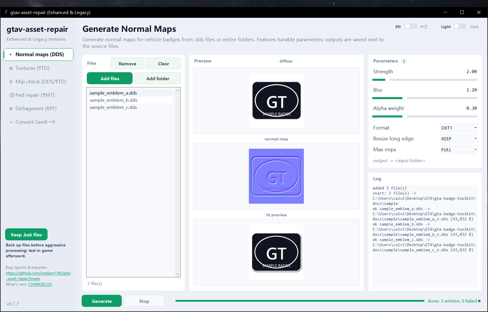

# GTA5 tools

**Enhanced & Legacy** texture and ped work for GTA V — find and fill short mip chains, shrink `.ytd`
archives without breaking them, audit `.ymt` ↔ `.ydd` pairs, and build badge normal maps.
Desktop app, CLI, and a DeepSeek Harness bundle.

[](https://github.com/wokken198/gtav-asset-repair/actions/workflows/tests.yml)
[](https://github.com/wokken198/gtav-asset-repair/releases/latest)



**[Download the portable build](https://github.com/wokken198/gtav-asset-repair/releases/latest)** — unzip,
run `gtav-asset-repair.exe`. No Python needed. `texconv.exe` is bundled; CodeWalker is only needed on the
pages that read or write archives, and the app finds it or you point at its folder once.

## What it does

| page | job | CodeWalker |
|---|---|---|
| **Normal maps (DDS)** | badge diffuse → tangent-space normal map, with strength / blur / alpha weight | not needed |
| **Textures (YTD)** | shrink the textures inside a `.ytd`, keep a `.bak` | needed to write |
| **Mip check (YTD/DDS)** | report short mip chains, then rebuild the archive with full ones | needed to write |
| **Ped repair (YMT)** | check `.ymt` against its `.ydd`, correct the drift | needed for both |

`Analyze` and `mip check` read only the RSC7 header, so they work before CodeWalker is set up — that is
why you can size up a pack in a second without touching a single file.


## Measured savings

Real packs, before → after, every write leaving a `.bak` behind:

| pass | before | after | delta |
|---|---|---|---|
| 10 ped/vehicle `.ytd` (3 Legacy + 7 Enhanced), capped to 1024 | 2092 MB VRAM | 758 MB VRAM | **−64%** |
| same run, file size | 155.2 MB | 70.4 MB | **−55%** |
| gen8 ped `.ytd`, 2048² textures capped to 1024 | 21.4 MB | 6.8 MB | **−68%** |
| 16-texture 2048² ped `.ytd`, rescaled to 1536 | 16.6 MB | 10.6 MB | **−36%** |
| 386 vehicles / 796 badge textures, rebuilt at 256 DXT5 with full mips | 65.4 MB | 44.1 MB | **−33%** |

Mip work goes the other way: a 4-file dictionary with 25 short chains went from `25 incomplete` to
`0 incomplete` in one pass, and two add-on peds whose `.ymt` declared 3 and 10 drawables for a 2-drawable
`.ydd` were repaired, re-read and verified.

| Analyze — estimate only, nothing written | Compress — 9 written, 1 skipped |
|---|---|
|  |  |

## Install

**Windows, no Python:** download `gtav-asset-repair-portable.zip` from the
[latest release](https://github.com/wokken198/gtav-asset-repair/releases/latest), unzip the **whole folder**
(the exe needs `_internal/` next to it) and run `gtav-asset-repair.exe`.

**From source:**

```bash
pip install -e .
```

Python 3.9+, `numpy`, `Pillow`. Two optional bits, each needed only by the commands that use them:

- **texconv.exe** (DirectXTex) — `normals`, `scale`; on `PATH`, next to the exe, or pass `--texconv`.
- **CodeWalker.Core.dll** (dev48+) with Windows PowerShell — `pack`, `lite`, `mips fix`, `ped check|fix`;
  found automatically, or pass `--core-dir` / set `GTA_TOOLS_CW`.

## Quick start

1. `Add folder` — point it at a folder of `.ytd` (or `.dds` for normal maps).
2. Pick the long-edge limit (`1024` is the usual sweet spot for vehicles).
3. `Analyze` → see VRAM and file savings before anything is written.
4. `Compress` → every file is rewritten in place, original kept as `<name>.bak`.
5. Launch the game and check the result. Anything that looks wrong: rename the `.bak` back.

The footer link and the note in the corner are there because step 5 is not optional for aggressive runs.

## CLI

Eight subcommands, all with the same `--json`, `--work` and error conventions:

| command | what it does |
|---|---|
| `gtav-asset-repair normals` | badge diffuse map → tangent-space normal map (DDS) + contact sheet |
| `gtav-asset-repair audit` | CPedVariationInfo (`.ymt`) check against vanilla's rules |
| `gtav-asset-repair scale` | DDS rescaling that keeps pixel format and mip depth |
| `gtav-asset-repair pack` | build a `.ytd` from a CodeWalker XML + a folder of DDS |
| `gtav-asset-repair ytd list` | read-only dump: name, size, format, mips per texture |
| `gtav-asset-repair mips check\|fix` | flag short mip chains, or rebuild the archive with full chains |
| `gtav-asset-repair lite` | shrink the textures inside `.ytd` files (cap / tier / agg) |
| `gtav-asset-repair ped check\|fix` | audit or repair `.ymt` ↔ `.ydd` pairs, keeping a `.bak` |

```bash
# normal map next to the source
gtav-asset-repair normals badge.dds --strength 4.5 --fmt DXT5

# what is inside an archive, and which chains are short
gtav-asset-repair ytd list car.ytd
gtav-asset-repair mips check car.ytd

# shrink a folder in place, originals kept as .bak
gtav-asset-repair lite "D:\mods\cars" --mode cap --cap 1024 --inplace

# ped audit, then repair (dry run first)
gtav-asset-repair ped check "D:\mods\peds"
gtav-asset-repair ped fix "D:\mods\peds" --apply
```

`--work DIR` anchors every default output below one folder; explicit `--out` still wins.
`mips check`, `mips fix` and `ped check` exit `2` when they find problems, so they can gate a build.

### Per-command notes

- **normals** — height = `0.7 * percentile-normalised luma + 0.3 * alpha`, Gaussian blur, gradient scaled
  by `--strength`; the atlas margin is forced flat to `(128,128,255)` so no rectangle shows around the art.
  Tuning: flat decals 8–10, chrome / baked specular 4–5, text-only 6–7. Default 4.5 matches vanilla badges
  (median slope 0.7–2.3°, bevels 25–35°).


- **scale** — RGB and alpha are resized **separately** (Pillow premultiplies alpha and darkens translucent
  art); target size rounds to a multiple of 4; mip depth is preserved but capped to the new chain.
- **pack** — `--original` copies `G9_UsageData / G9_Flags / UsageData / UsageFlags / ExtraFlags` from an
  existing archive by texture name. CodeWalker's XML export drops those gen9 render-target bits; without
  them the archive still loads but scripted render targets (dashboard dials) crash when drawn.
- **lite** — `cap` scales anything longer than the limit; `tier` snaps to 1024/1536/2048; `agg` adds format
  swaps (uncompressed → DXT5, opaque DXT5 → DXT1). `script_rt_*`, normal, `spec`/`gloss`/`dirt`/`mask`
  keep their format, and nothing under 1024 px is touched.
- **ped check|fix** — the key is the **slot index inside `availComp`**, not the component's position;
  `numAvailTex` is the sum of `aTexData` over that component's drawables; `texId` is a race suffix, not a
  texture slot. `fix` is a dry run unless `--apply`, and it re-reads what it wrote.

## Enhanced & Legacy

| area | Enhanced (gen9) | Legacy (gen8) |
|---|---|---|
| `normals`, `scale` (plain DDS) | yes | yes — DDS has no container version |
| `ytd list`, `mips check\|fix`, `lite` | yes | yes — detected from the RSC7 header |
| `pack` | version 5, default | version 13, pass `--legacy` |
| `ped check\|fix` | yes | yes — picked from the `.ydd` header |

**Both generations, one batch.** Every archive is read and written at its own RSC7 version (5 = Enhanced,
13 = Legacy), so a mixed pack stays mixed: no silent upgrade, no re-save into the wrong generation.

That does *not* mean a Legacy file becomes usable in the Enhanced edition — it stays Legacy, and you still
convert it with CodeWalker. The app tells you when it spots one.

Archives go through **CodeWalker.Core** (C#); the Python layer only orchestrates. That is why ped repair
refuses to write when the local CodeWalker build shuffles `.ymt` components (some dev builds do — the tool
says so instead of producing a broken file).

## Safety rules

- **Backups** — anything written in place leaves `<name>.bak`; an older `.bak` is replaced only after the
  new file has been read back and verified.
- **Dry run by default** — `ped fix` prints the plan, nothing is written without `--apply`.
- **No silent format changes** — shrinking only touches dimensions; format swaps happen only in `agg` mode,
  and never on `script_rt_*`, normal maps or `spec`/`gloss`/`dirt`/`decal`/`mask` textures where alpha
  carries shader data.
- **Verify before publishing** — every rebuilt archive is re-read and its texture count compared with the
  source; a mismatch deletes the output instead of shipping it.
- **Guard rails** — a gen9 archive parsed as legacy returns zeroed sizes, so the header is checked and a
  mismatch fails loudly rather than printing plausible nonsense.

## Known pitfalls this repo encodes

- **XML → `.ytd` is lossy** for `script_rt_*`: always pack with `--original` when you have a reference.
- **CodeWalker's DDS export flattens A8R8G8B8 to 8 bpp grayscale**, so exported statistics lie for
  mask-style textures (plate fonts, glyph atlases). Read `TextureData.FullData` if it matters.
- **Legacy vertex data** exports as `<Data2>` while the importer reads `<Data>` — XML round trips silently
  drop legacy meshes; merge legacy peds from the binary.
- **Patch-DLC override order follows `dlclist.xml`**, not `setup2.xml`'s `<order>`: a texture in a
  later-loading pack wins even when an earlier pack declares the same name.
- **Pillow ≥12 premultiplies alpha** when resizing RGBA, which darkens translucent art: scale channels apart.

## Performance

- Parsing a `.ytd` costs ~1.5 s via CodeWalker; a 40-archive scan is ~25 s, done in the background in the GUI.
- Shrinking is dominated by texture count and size: a 76-archive car pack takes a few minutes because every
  texture is decoded and re-encoded.
- Two numbers are reported — **VRAM** (decoded footprint, what matters in game) and **file size** (what is
  read from disk). gen9 archives are zlib-compressed, so file size is much smaller than VRAM.

## Development

```bash
python -m unittest discover -s tests -v     # 45 tests
```

```bash
powershell -ExecutionPolicy Bypass -File packaging/build_win.ps1   # exe + portable zip
```

```
src/gtav_asset_repair/   cli.py, dds.py, normals.py, ymt.py, ped.py, cw.py, ytd.py, lite.py, gui.py, gui_pages.py
tests/                   test_core.py, test_lite.py, test_gui.py
resources/               PowerShell helpers (ytd xml export/pack)
packaging/               PyInstaller entry point, build script, portable README
dsh-plugin/              DeepSeek Harness bundle (nine agent tools)
market/                  DSH market index entry
docs/                    docs/README.md, why-mips.md, ped-ymt-rules.md, images/
```

## Building on this

Putting a UI, a wrapper or a fork on top is welcome. If you reuse the code, keep the copyright notice and
say where it came from:

> Badge normal mapping and YTD tooling by wokken198, MIT licensed — https://github.com/wokken198/gtav-asset-repair

That is what the MIT license already asks for; the link back is courtesy. Not fine: shipping the bundled
`dsh-plugin/` or a copy of this code without the notice, or redistributing game assets (`.dds`, `.ytd`,
`.ydd`, `.ymt`, brand art) as if they were yours — none of those are in this repository to begin with.

## Optional: DeepSeek Harness bundle

`dsh-plugin/` exposes the same operations as agent tools (`gta_badge_normal`, `gta_ytd_lite`,
`gta_ped_check`, `gta_ped_fix`, …). The Python package is vendored inside, so nothing needs to be
pip-installed. Details: [dsh-plugin/docs/DETAIL.md](dsh-plugin/docs/DETAIL.md).

## 中文简介

**GTA5 tools** 是一个面向 **GTA V（增强版 gen9 / 旧版 gen8）** 的贴图与 PED 处理工具，桌面版和命令行都有。

四件事：**车标法线生成**、**YTD 贴图压缩**（降分辨率、降显存）、**Mip 链检查与补全**（消除远处闪烁）、
**PED 的 `.ymt` / `.ydd` 校验与修复**（解决模型错位、LOD 异常、出生崩溃）。

特点：处理前先用 `分析` 给出显存与体积预估；所有原地写入都留 `.bak`；压缩不会偷偷改格式（只有「激进」模式才换，
且跳过 `script_rt_*`、法线、spec 类贴图）；两个世代的文件可以混在一批里处理，各自按原版本写回。
它不修复模型本体，也不替代 OpenIV / CodeWalker / Sollumz。

## License

MIT for the code. Game-derived assets are not covered and are not shipped here.
