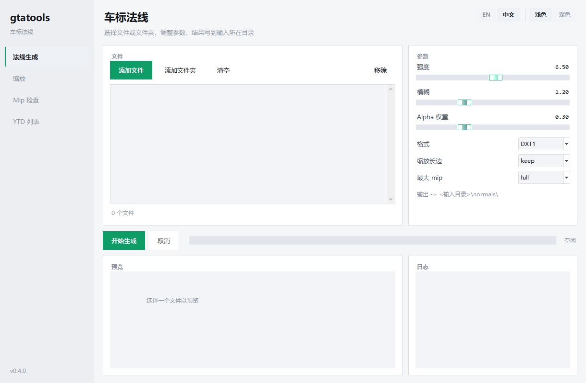
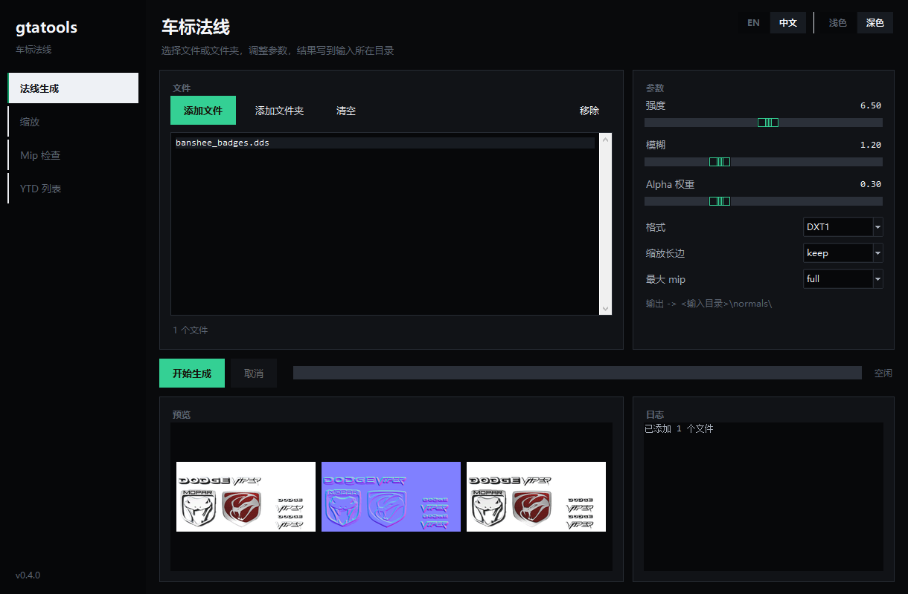
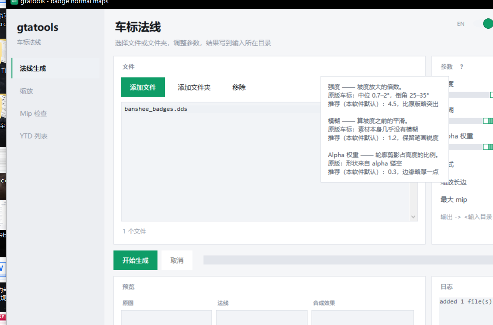
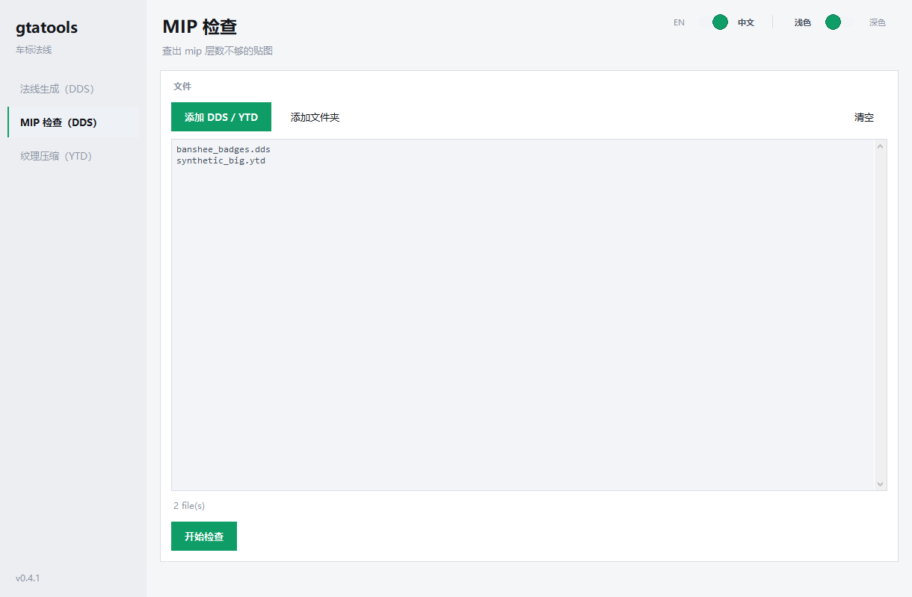
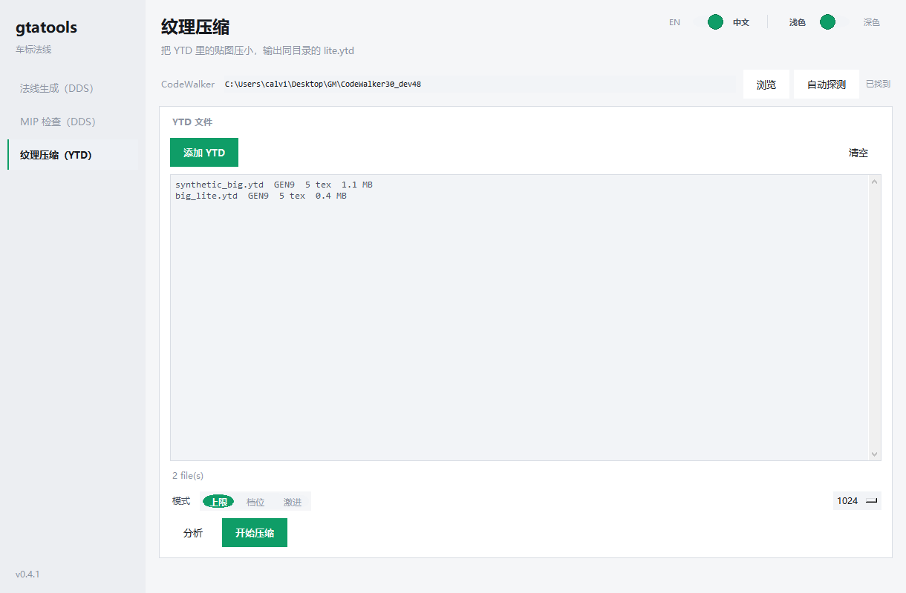

# GTA5 tools

**Enhanced & Legacy** texture and ped work for GTA V — check mip chains, shrink `.ytd` files, audit
`.ymt` ↔ `.ydd` pairs, and build badge normal maps. Desktop app, CLI, and a DeepSeek Harness bundle.

[](https://github.com/wokken198/gtav-toolkit/actions/workflows/tests.yml)
[](https://github.com/wokken198/gtav-toolkit/releases/latest)


**[Download the portable build](https://github.com/wokken198/gtav-toolkit/releases/latest)** — unzip,
double-click `gtatools.exe`, done. No Python needed; the only extra is CodeWalker for the pages that
read or write archives (the app finds it, or you point at its folder).

What it saves you, measured on real packs (before → after, all with a `.bak` kept):

| pass | before | after | delta |
|---|---|---|---|
| gen8 ped `.ytd`, 2048² textures capped to 1024 | 21.4 MB | 6.8 MB | **−68%** |
| gen9 vehicle `.ytd`, capped to 1024 (4 files) | 3.3 → 1.4 MB each | 2.1 → 1.1 MB each | **−18% … −50%** |
| 386 vehicles, 796 badge textures, rebuilt at 256 DXT5 with full mips | 65.4 MB | 44.1 MB | **−33%** |
| 16-texture 2048² ped `.ytd`, rescaled to 1536 | 16.6 MB | 10.6 MB | **−36%** |

Same tool, the other way round: a 4-file texture dictionary with 25 short mip chains went from
`25 incomplete` to `0 incomplete` in one pass, and two add-on peds whose `.ymt` declared 3 and 10
drawables for a 2-drawable `.ydd` were repaired, re-read, and verified.

Four GUI pages, nine CLI commands, nine agent tools:

| command | what it does |
|---|---|
| `gtatools normals` | badge diffuse map → tangent-space normal map (DDS) + contact sheet |
| `gtatools audit` | CPedVariationInfo (`.ymt`) consistency check against vanilla's rules |
| `gtatools scale` | DDS rescaling that keeps pixel format and mip depth |
| `gtatools pack` | build a `.ytd` from a CodeWalker XML + a folder of DDS |
| `gtatools ytd list` | read-only dump of a texture dictionary (name, size, format, mips) |
| `gtatools mips check\|fix` | flag short mip chains, or rebuild the archive with full chains |
| `gtatools lite` | shrink the textures inside `.ytd` files (cap / tier / aggressive) |
| `gtatools ped check\|fix` | audit or repair `.ymt` ↔ `.ydd` pairs, keeping a `.bak` |

No game assets are included; everything reads from your own install.

## Scope: what this is, and what it is not

**It is** a pipeline for the boring, error-prone parts of texture and ped-variation work: making
badge normal maps, finding and filling short mip chains, shrinking `.ytd` archives without breaking
them, and catching `.ymt` / `.ydd` drift before a ped crashes in game.

**It is not** a resource editor. It cannot open models, maps, vehicles metas, ymap or audio, and it
does not replace OpenIV, CodeWalker or Sollumz. It never touches geometry: `ped fix` rewrites
numbers inside the `.ymt` — a damaged `.ydd` (broken mesh, wrong vertex layout) stays broken.

| area | Enhanced (gen9) | Legacy (gen8) |
|---|---|---|
| `normals`, `scale` (plain DDS) | yes | yes — DDS has no container version |
| `ytd list`, `mips check`, `lite`, `pack` | yes | yes: auto-detected by header for `lite` / `mips`, `--legacy` for the rest |
| `ped check`, `ped fix` | yes | yes — the gen8/`gen9` loader is picked from the `.ydd` header (RSC7 v165 = Legacy) |

Everything that reads or writes an RSC7 archive goes through **CodeWalker.Core** (C#); the Python
layer only orchestrates it. That is why CodeWalker is a requirement rather than an implementation
detail — and why the ped repair refuses to write when the local CodeWalker build shuffles `.ymt`
components (older dev builds do; the tool says so instead of producing a broken file).

## Safety rules the tools follow

- **Backups**: anything written in place leaves `<name>.bak` next to the original; an older `.bak`
  is replaced only after the new file has been read back and verified.
- **Dry run by default**: `ped fix` prints the plan; nothing is written without `--apply`
  (the GUI asks per selection).
- **No silent format changes**: shrinking only touches dimensions. Format swaps happen only in the
  `agg` mode, and never on `script_rt_*`, normal maps or `spec` / `gloss` / `dirt` / `decal` / `mask`
  textures, where the alpha channel carries shader data.
- **Nothing under 1024 px** is resized, and a texture whose mip chain is already complete is left
  alone. `mips fix` skips `script_rt_*` entirely — those are render targets, not sampled images.
- **Verify before publishing**: every rebuilt archive is re-read and its texture count compared with
  the source; a mismatch deletes the output instead of shipping it.

## Try it in one minute

```bash
# a badge texture -> normal map next to the source
gtatools normals badge.dds --strength 4.5 --fmt DXT5

# what is inside an archive, and which mip chains are short
gtatools ytd list car.ytd
gtatools mips check car.ytd

# shrink every .ytd in a folder, keeping the previous file as .bak
gtatools lite "D:\mods\cars" --mode cap --cap 1024 --inplace

# ped audit, then repair (dry run first)
gtatools ped check "D:\mods\peds"
gtatools ped fix "D:\mods\peds" --apply
```

## Performance notes

- Parsing a `.ytd` costs about 1.5 s per file through CodeWalker, so a 40-archive pack takes ~25 s to
  scan; the GUI does that in the background.
- Shrinking is dominated by texture count and size, not by the archive: a 76-archive car pack takes
  a few minutes because every texture is decoded and re-encoded.
- Estimates are reported two ways — **VRAM** (the decoded footprint, what matters in game) and
  **file size** (what the game loads from disk). In gen9 the archive is zlib-compressed, so the file
  number is much smaller than the VRAM number.


## Features

- **Normal map generate** — single `.dds` or a whole folder, tunable parameters; builds normal maps for vehicle badges and writes them next to the source.
- **Texture compression** — batch-shrink the textures inside `.ytd` files and write them back to the same folder; the original file is backed up as `.bak`.
- **Mipmap check & fill** — detect missing mip levels and fill the chain automatically; fixes shimmer and moire at distance and cuts render cost. The original `.ytd` / `.dds` is backed up as `.bak`.
- **PED YMT repair** — validate a `.ymt` against its `.ydd`, correct the parameter drift; fixes misplaced parts, broken LODs, wrong textures, random loading and spawn crashes.

## 功能简介

- **法线生成** — 支持单张 DDS 或批量目录导入，可配置参数，专为车标贴图生成法线贴图，输出至原目录。
- **纹理压缩** — 批量压缩 YTD 内贴图，输出至同目录；原文件自动备份为 `.bak`。
- **Mipmap 校验与补全** — 检测贴图 Mip 链缺失，自动补齐 Mip 层级，改善远距离贴图闪烁、摩尔纹问题，优化渲染性能；原 YTD/DDS 自动备份为 `.bak`。
- **PED YMT 修复** — 校验 YMT 与 YDD 资源匹配关系，修正参数偏差，解决模型错位、LOD 异常、贴图错乱、随机加载及 Spawn 崩溃。

支持 **Enhanced（gen9）与 Legacy（gen8）** 贴图与 PED 文件（`.ydd` 头部是 RSC7 v165 就按 Legacy 读）。本工具只改贴图与 `.ymt` 参数，不修复模型本体，也不替代 OpenIV / CodeWalker / Sollumz。


## What it does to a real pack

| pass | before | after | delta |
|---|---|---|---|
| 386 vehicles, 796 badge textures (rebuilt at 256, DXT5, full mips) | 386.9 MB | 373.2 MB | −13.7 MB |
| badge payload only | 65.4 MB | 44.1 MB | **−33%** |
| a 16-texture 2048² ped `.ytd`, rescaled to 1536 | 16.6 MB | 10.6 MB | **−36%** |
| 190 oversized DDS, long edge 2048 → 1536 | 820.8 MB | 521.4 MB | −36% |

Zero failures across those batches, and a pack → export → compare round trip came back
byte-identical on the sampled files.

## Game versions

`normals` and `scale` are version-agnostic: they take DDS files and the rules they encode (DXT1/5,
BC7/BC5, full mip chains, dimensions rounded to 4) are the same in Legacy and Enhanced.

`pack` is where the two games differ:

- **Enhanced (gen9)** archives are RSC7 version 5. That is the default; add `--original` to restore
  the `script_rt_*` render-target descriptors that CodeWalker's XML export drops.
- **Legacy** archives are RSC7 version 13. Pass `--legacy`. Those `G9_*` descriptor fields do not
  exist there, so `--original` is not needed for them. `ytd list` and `mips check` read the RSC7 header
  and warn when the flag disagrees with the file — parsing a gen9 archive as legacy yields zeroed sizes.
- Legacy `.ydd` XML round trips silently lose meshes (the exporter writes `<Data2>`, the importer
  reads `<Data>`), so merge legacy peds from the binary files rather than from XML.

## Docs

Start at [docs/README.md](docs/README.md) for a one-table map of the repository: which page to read for
the CLI, for the DeepSeek Harness bundle, for the market index, and for the pitfalls below. The bundle's
internals are described in [dsh-plugin/docs/DETAIL.md](dsh-plugin/docs/DETAIL.md).

## Install

**Windows, no Python:** grab `gtatools-portable.zip` from the
[latest release](https://github.com/wokken198/gtav-toolkit/releases/latest), unzip it anywhere and run
`gtatools.exe`. Unzip the folder as a whole — the exe needs the `_internal` folder next to it.

**From source:**

```bash
pip install -e .
```

Python 3.9+, `numpy`, `Pillow`. Two optional dependencies, needed only by the commands that use them:

- **texconv.exe** (DirectXTex) — required by `normals` and `scale`; on `PATH`, in the working directory
  tree, or passed with `--texconv` / `GTA_TOOLS_TEXCONV`.
- **CodeWalker.Core.dll** (dev48+) plus Windows PowerShell — required by `pack`; located through
  `--core-dir`, `GTA_TOOLS_CW`, or the common-install probe described below.

## One folder for a whole run

Pass `--work DIR` (before or after the command) and every default output lands below that folder, so a
job leaves nothing scattered in the current directory:

```bash
gtatools --work "D:\mods\NEW" normals "D:\mods\NEW\badges" --sheet "D:\mods\NEW\sheet.png"
# outputs: D:\mods\NEW\normals\
#          D:\mods\NEW\scaled\      (scale)
#          D:\mods\NEW\packed\      (pack, when --out is omitted)
```

Inputs can live anywhere; only the *outputs* are anchored to `--work`. Explicit `--out` / `--json`
arguments still win, so nothing changes for scripts that already pass paths.

## normals

```bash
gtatools normals <src> --out out --sheet sheet.png
# defaults: --strength 6.5 --blur 1.2 --fmt DXT5 --max-mips 12
```

For every `*badge*.dds` that is not already a normal map:

1. decode with texconv → RGBA
2. height = `0.7 * percentile-normalised luma + 0.3 * alpha`, then Gaussian blur (`--blur`)
3. gradient → normal, slope scaled by `--strength`
4. margin (alpha ≈ 0) forced to `(128,128,255)` — otherwise the atlas cell border keeps a slope and
   shows up as a faint rectangle around the engraving
5. encode with a full mip chain (`--max-mips` caps it)

Tuning: flat decals 8–10, chrome / baked-specular art 4–5, text-only art 6–7.


## audit

```bash
gtatools audit ped.ymt.xml --json report.json
```

Checks against what vanilla peds actually do:

- `numAvailTex(component) == sum(aTexData)` over that component's drawables
- `compInfos` has exactly one entry per `(slot, drawable)`; the key is the **slot index inside
  `availComp`**, not the component's position in `aComponentData3`
- `texId` is a race suffix (`0 uni, 1 whi, 2 bla, 3 chi, 4 lat, 5 ara, 10 pak`), not a texture slot
- dangling components (declared in the .ymt but with no drawable in the .ydd) and count mismatches

Exit code `2` when problems are found, so it can gate a build.

## scale

```bash
gtatools scale <paths...> --out resized --long-edge 1536 --min-edge 1025
# --min-edge skips anything whose long edge is already <= that value
```

- decodes with texconv, resizes RGB and alpha **separately** — Pillow's RGBA Lanczos premultiplies
  alpha and darkens semi-transparent art — then re-encodes in the original format
- target size is rounded to a multiple of 4; mip count is preserved but capped to the new chain
- unsupported formats are skipped and reported, never half-written
- an output tree mirroring the inputs is built under `--out`

## pack

```bash
gtatools pack --xml vehshare.ytd.xml --build build_dir --out vehshare.ytd \
              --original vanilla_vehshare.ytd
```

`--original` copies `G9_UsageData / G9_Flags / UsageData / UsageFlags / ExtraFlags` from an existing
archive, matched by texture name. This matters: CodeWalker's XML export does not carry the gen9
render-target descriptor bits, and losing them breaks scripted render targets (dashboard dials and
similar) — the archive still loads, the game crashes when the target is drawn.

`--legacy` writes gen9=off (version 165 assets). `--core-dir` overrides the CodeWalker location; when
it is omitted the CLI probes `GTA_TOOLS_CW`, `CODEWALKER_DIR`, common install paths, and the working
directory's parents.

## ytd list

```bash
gtatools ytd list car.ytd --only badge
gtatools ytd list cars/*.ytd --json
```

Reads a texture dictionary and prints one line per texture: name, size, format, mips. `--only` filters
by substring. `--json` alone prints JSON to stdout, `--json out.json` writes a file — the same convention
`audit` and `mips check` use. Needs CodeWalker (`CodeWalker.Core.dll`); nothing is written. Exit code `2`
if an archive cannot be read.

## mips check

```bash
gtatools mips check extracted/                 # .ytd and .dds side by side
gtatools mips check a.dds b.dds --all
```

Mip chains are the one defect you cannot see in a still screenshot: a 256×128 texture needs 9 levels
(`floor(log2(256)) + 1`), and a file that ships 1 level aliases into a shimmering mess as soon as the
camera moves. This subcommand reports `mips/expected` per texture; `.dds` files are parsed in pure
Python, `.ytd` files go through CodeWalker. Exit code `2` when anything is incomplete, so it can gate
a build. See [docs/why-mips.md](docs/why-mips.md) for the long version.

## GUI

A small desktop window ships next to the CLI, for people who would rather not type:







- four pages: normal maps (DDS), texture compression (YTD), mipmap check & fill, ped YMT repair
- pick files, or a whole folder (it walks subdirectories for `*.dds`)
- strength / blur / alpha weight sliders, format, resize and mip options; the circled `?`
  next to *Parameters* explains each one, including what vanilla badges measure
- the left column keeps a fixed width in both languages, so nothing jumps when you switch to English
- the mipmap page says outright that `script_rt_*` textures are left alone, and why
- three live previews: the source texture, the generated normal, and a shaded result
- batch run with a progress bar, an English one-line-per-file log and cancel
- output lands in `normals\` next to each input, so nothing is overwritten; if that
  folder refuses the write it falls back to `_n_2.dds`, `_n_3.dds` …
- scratch files go to `%TEMP%\gtatools\` and are deleted as the run proceeds
- English / Chinese and light / dark, as fixed-width switches in the header; the last
  choice is remembered
- texconv.exe is bundled in the packaged build, so it needs no Python and no setup
- three pages in the sidebar: **Normal map (DDS)**, **Mip check (DDS)** and
  **Texture compression (YTD)**





Run it from a checkout with `python -m gtatools.gui` (or `gtatools-gui` after `pip install -e .`).
To build the Windows exe:

```bash
pip install pyinstaller
pyinstaller --noconfirm --clean --onefile --windowed --name gtatools \
  --runtime-tmpdir . \
  --icon resources/gtatools.ico \
  --add-binary "texconv.exe;." \
  --add-data "resources/gtatools.ico;resources" \
  --paths src --hidden-import PIL.ImageTk packaging/gui_entry.py
```

The one-file build unpacks itself next to the exe (`--runtime-tmpdir .`), so it starts
even where `%TEMP%` is locked down; keep it in a folder you can write to. Protected
folders (the Desktop under Defender's controlled-folder access, for instance) block that
unpack — build with `--onedir` for those, since a folder build never unpacks anything and
runs from wherever it sits.

## Texture compression (YTD)

The third page shrinks the textures inside an existing `.ytd` and writes a copy next to
it, so you can keep the original:

- **Cap** - any texture whose long edge is above the limit is scaled down to it
- **Tier** - the long edge snaps to 1024 / 1536 / 2048, whichever is closest below
- **Aggressive** - Cap, plus format swaps that are safe to automate: uncompressed becomes
  DXT5, an opaque DXT5 becomes DXT1. Normal maps and `spec` / `gloss` / `dirt` / `mask`
  style textures keep their format, `script_rt_*` ones are never touched, and anything
  under 1024 px is left alone

Mip chains are rebuilt for the new size when the source had them, and kept at one level
when it did not. The result is `lite.ytd` (or `lite_2.ytd`, `lite_3.ytd` …) plus
`lite_report.txt`, which lists every texture and what happened to it.

Packing needs [CodeWalker](https://dexyfex.com/)'s `CodeWalker.Core.dll` - point the page
at that folder once and it is remembered. Archives are read and written in the same
version they came in: RSC7 version 5 is GEN9 and is tagged that way in the list, version
13 is Legacy, and the page warns before you compress one.

## Known pitfalls this repo encodes

- **XML → `.ytd` round trip is lossy** for `script_rt_*` textures; always pack with `--original` when you have a
  reference archive.
- **CodeWalker's DDS export flattens A8R8G8B8 to 8 bpp grayscale**, so exported channel statistics lie
  for mask-style textures (plate fonts, glyph atlases); read `TextureData.FullData` if it matters.
- **Legacy (gen8) vertex data** is exported as `<Data2>` while the importer only reads `<Data>` —
  round-tripping a legacy `.ydd` through XML silently drops its meshes. Merge legacy peds from binary.
- `.ymt` `availComp` appears either as spaced decimals or one hex blob; both forms are parsed here.
- Patch-DLC override order follows `dlclist.xml`, not the `<order>` element in `setup2.xml`: a texture
  shipped in a later-loading pack wins even when an earlier pack declares the same name.
- Pillow ≥12 premultiplies alpha when resizing RGBA, which darkens translucent art: scale channels
  separately.

## Tests

```bash
python -m unittest discover -s tests -v
```

11 tests, covering DDS header parsing (DXT5 / DX10 BC7 / A8R8G8B8 / rejection), the normal-map maths
(flat in → flat out, margin flattening, luma direction) and the ymt audit rules (consistent, wrong
`numAvailTex`, missing `compInfo`, hex `availComp`).

## Layout

```
src/gtatools/       cli.py, dds.py, normals.py, ymt.py, cw.py, ytd.py, gui.py
tests/              test_core.py
resources/          pack_ytd.ps1
dsh-plugin/         DSH bundle (nine agent tools, index.js, locale/, vendor/gtatools, icon.svg)
packaging/          PyInstaller entry point for the GUI
market/             market index entry
docs/               docs/README.md and docs/images/ artwork
.github/            tests workflow
```

## Building on this

You are welcome to put a UI, a GUI wrapper, or a fork on top of this code — a
standalone desktop app for badge work is an obvious next step, and this repository
is meant to be the engine for it.

If you reuse the code, **keep the copyright notice and say where it came from**,
e.g.:

> Badge handling based on [gtav-toolkit](https://github.com/wokken198/gtav-toolkit)
> by wokken198, MIT licensed.

That attribution requirement is the one thing the MIT license already asks for
(keep the notice); the link back is courtesy, and it is how people find the
original when they need the CLI or the fixes. Forking, renaming, adding a GUI,
using only the normal-map maths, or wrapping the CLI in your own app are all fine.

Not fine: shipping the bundled `dsh-plugin/`, or a copy of this code, without the
notice; or redistributing game assets (`.dds`, `.ytd`, `.ydd`, `.ymt`, brand art)
as if they were yours — none of those are in this repository to begin with.

## Optional: DeepSeek Harness bundle

`dsh-plugin/` exposes the same operations as agent tools (`gta_badge_normal`, `gta_ytd_lite`,
`gta_ped_check`, `gta_ped_fix`, …) for people who drive their work from an agent. The Python package is
vendored inside the bundle, so nothing needs to be pip-installed. Details and environment variables:
[dsh-plugin/docs/DETAIL.md](dsh-plugin/docs/DETAIL.md).

## License

MIT for the code. Game-derived assets are not covered and are not shipped here.
