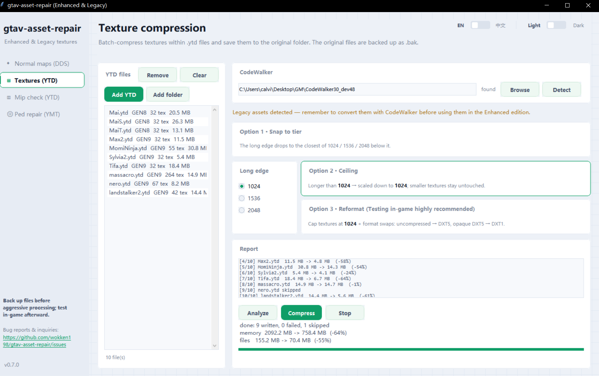
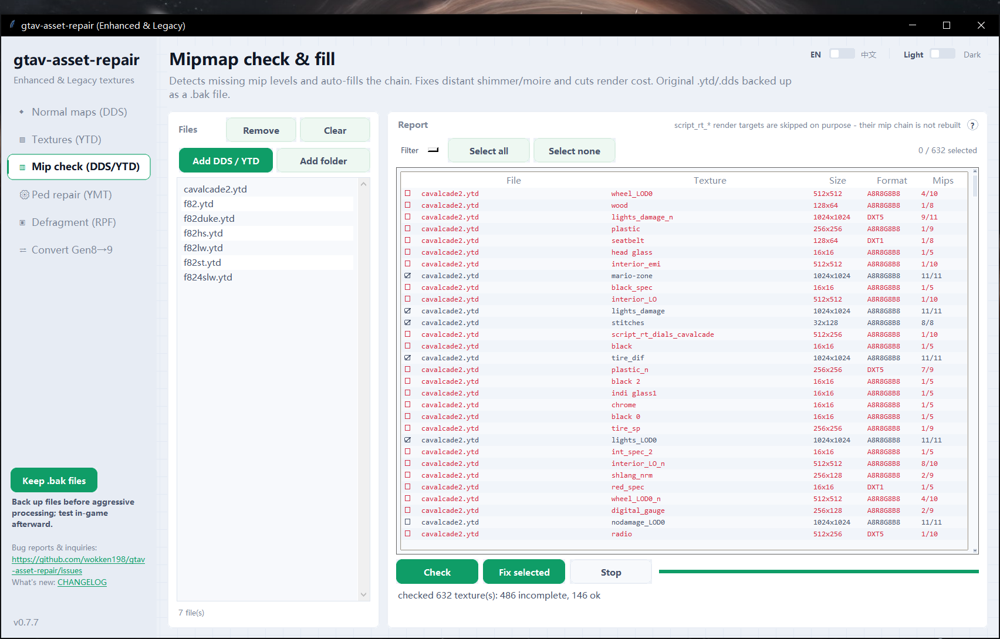
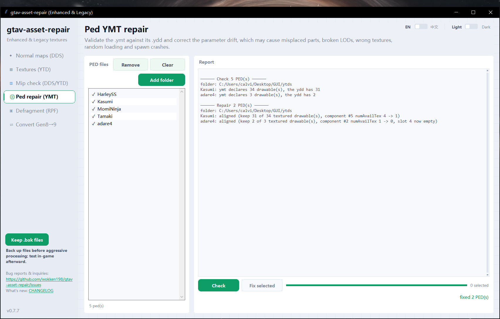
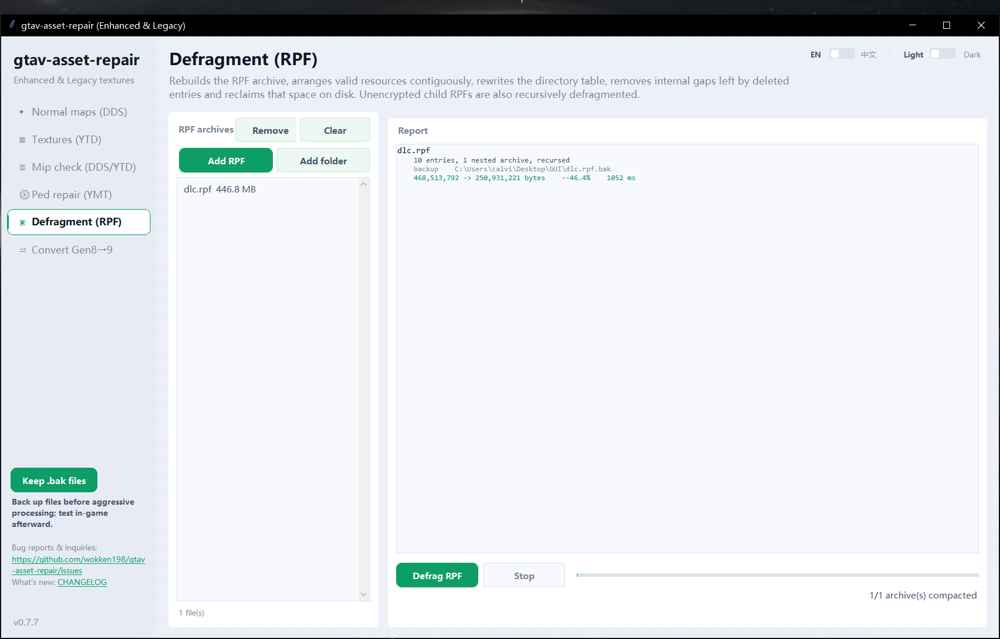

# gtav-asset-repair

> **A note from the author:** I put this together in a week, building one feature a day. I'm stopping
> feature development for now, unless a breaking issue comes up.
>
> If this tool helped you out, a link back to
> <https://github.com/wokken198/gtav-asset-repair> would be much appreciated. The license requires you
> retain the copyright notice; linking back or crediting wokken198 is just a kind gesture, not required.

[](https://github.com/wokken198/gtav-asset-repair/actions/workflows/tests.yml)
[](https://github.com/wokken198/gtav-asset-repair/releases/latest)
[](LICENSE)


**Enhanced & Legacy** workbench for GTA V. Six pages, all running on bundled readers: convert Legacy
`.ytd` / `.ydd` / `.yft` into the gen9 layout, generate badge normal maps, shrink texture dictionaries,
fill short mip chains, audit `.ymt` ↔ `.ydd` pairs, and defrag `.rpf` archives. Desktop app, CLI, and a
DeepSeek Harness bundle. No CodeWalker, no external converter, no external texture tool.

**[Download the portable build](https://github.com/wokken198/gtav-asset-repair/releases/latest)** — unzip,
run `gtav-asset-repair.exe`. No Python needed, `texconv.exe` is bundled.

Jump to: [Convert Gen8→9](#1-convert-gen89) ·
[Normal maps](#2-normal-maps-dds) · [Texture compression](#3-texture-compression-ytd) ·
[Mip check](#4-mip-check-ytddds) · [Ped repair](#5-ped-repair-ymt) · [Defrag](#6-defrag-rpf) ·
[Install](#install) · [Quick start](#quick-start) · [CLI](#cli) · [Safety](#safety-rules) ·
[Limits](#known-limits) · [中文](#中文简介)

## What it does

| page | job |
|---|---|
| **Convert Gen8→9** | rebuild Legacy `.ytd` / `.ydd` / `.yft` in the gen9 layout, copy `.ymt` / `.yld` unchanged |
| **Normal maps (DDS)** | badge diffuse → tangent-space normal map, with strength / blur / alpha weight |
| **Textures (YTD)** | shrink the textures inside a `.ytd`, keep the source |
| **Mip check (YTD/DDS)** | report short mip chains, then rebuild the archive with full ones |
| **Ped repair (YMT)** | check `.ymt` against its `.ydd`, correct the drift |
| **Defrag (RPF)** | rewrite an `.rpf` so its payload is contiguous again, reclaiming the space left by replaced files |

### 1. Convert Gen8→9

Rebuild Legacy `.ytd` / `.ydd` / `.yft` in the gen9 layout; copy `.ymt` / `.yld` unchanged.


Point it at a folder and press Convert. Every archive comes out at its own new version (13 → 5 for
textures, 165 → 159 for drawables, 162 → 171 for fragments), with a report line per file and a total at
the end. Already-gen9 files are skipped, so re-running is safe. A 13 MB body file takes about eight
seconds; one car — body, `_hi` and paint — about fifteen.

**Why it rewrites instead of patching.** CodeWalker's Asset Converter and Cfx's Alchemist patch bytes in
place: fast, and fine for what they preserve. This tool decodes every field, rebuilds it in the gen9
layout and compares the result against its source, which catches three things a patcher cannot:

| | CodeWalker | Alchemist | this tool |
|---|---|---|---|
| `script_rt_*` render-target flag | lost (`0`) | rewritten (`0x40010`) | kept as authored (`0x1010000`) |
| fragment runtime class VFTs | left on the legacy table | left as authored | switched to gen9 |
| gen9 material defaults | zeroed | partial | filled from the gen9 definitions |

The first row is not cosmetic. A `.ytd` that carries a dashboard render target and loses its flag
crashes the game the instant the car spawns — no texture shows, no error logged, the pack simply does
not load. It took a day of bisecting to find, and the fix is one line once you know the field is
load-bearing. A patcher reading that file as bytes has no reason to look at it.

Rewriting costs speed and buys two things: **every output field can be compared against its source**
(`gen8to9 --json` reports per-file results, and the test suite pins whole-file comparisons against
retail gen9 samples), and **nothing is written that the target format does not define** — unknown legacy
material parameters are dropped at write time instead of being carried into a format that ignores them.

If you only ever touch vanilla-shaped assets and want the fastest possible conversion, a patcher will
do. If a pack comes from a third-party tool and misbehaves after conversion, the rewrite path tells you
*which* field was wrong instead of handing you a black box.

**Both generations, one batch.** Every archive is read and written at its own RSC7 version (5 =
Enhanced, 13 = Legacy), so a mixed pack stays mixed: no silent upgrade, no re-save into the wrong
generation. `gen8to9` is the explicit step that upgrades one, and anything it cannot decode is reported
as a skip with the original error text rather than written half-converted.

### 2. Normal maps (DDS)

Badge diffuse map → tangent-space normal map, with strength / blur / alpha weight.


Drop in a `.dds`, press Generate, and an `_n.dds` appears beside it with a lit preview of the result.
Height comes from luminance, so engraved lettering keeps its shape, and the atlas margin is forced flat
so no rectangle shows up around the text. **Strength defaults to 2.0**, which matches vanilla badge
intensity; raise it only if your result reads flat in game.

Made for people building their own real badges: a flat logo is a decal, a logo with a normal map catches
the light like the original. Parameter maths and the G-channel trap: [docs/pitfalls.md](docs/pitfalls.md).

### 3. Texture compression (YTD)

Shrink the textures inside a `.ytd`, keeping the source.



`Analyze` reads only the RSC7 headers and tells you what you would reclaim before anything is written;
`Compress` writes `<name>_lite.ytd` beside the source (`--inplace` on the CLI rewrites and keeps a
`.bak`). Three modes: cap anything over the limit, snap to the nearest 1024/1536/2048 tier, or also
swap uncompressed → DXT5 and opaque DXT5 → DXT1. `script_rt_*`, normal and spec maps keep their format,
and nothing under 1024 px is touched.

| pass | before | after | delta |
|---|---|---|---|
| 10 ped/vehicle `.ytd` (3 Legacy + 7 Enhanced), capped to 1024 | 2092 MB VRAM | 758 MB VRAM | **−64%** |
| same run, file size | 155.2 MB | 70.4 MB | **−55%** |
| gen8 ped `.ytd`, 2048² textures capped to 1024 | 21.4 MB | 6.8 MB | **−68%** |
| 16-texture 2048² ped `.ytd`, rescaled to 1536 | 16.6 MB | 10.6 MB | **−36%** |
| 386 vehicles / 796 badge textures, rebuilt at 256 DXT5 with full mips | 65.4 MB | 44.1 MB | **−33%** |

> **VRAM vs disk.** The VRAM numbers are yours the moment a file is rewritten. The *disk* numbers only
> become real after the archive holding those files is repacked — an `.rpf` keeps the old bytes as empty
> space until it is defragmented. That is what page 6 does.

### 4. Mip check (YTD/DDS)

Report short mip chains, then rebuild the archive with full ones.



A texture whose chain stops early shimmers and moirés as soon as the camera moves — it is the single
most common reason a modded car looks noisy at distance while vanilla cars nearby look calm. `Check`
lists every chain and flags the short ones; `Fix selected` rebuilds them with full chains and keeps a
`.bak`. `script_rt_*` render targets are skipped on purpose: their chain belongs to the game, not to the
file.

### 5. Ped repair (YMT)

Check `.ymt` against its `.ydd` and correct the drift.



A ped's `.ymt` declares how many drawables and textures each component has. When those numbers drift
away from what the `.ydd` actually ships — which is what happens when someone edits a component in
Blender and forgets the variation file — the game shows misplaced parts, broken LODs, or crashes on
spawn. `Check` compares the two, `Fix selected` trims the `.ymt` to what the `.ydd` really has and
re-reads the result to prove it parses back. The rules are in [docs/ped-ymt-rules.md](docs/ped-ymt-rules.md).

### 6. Defrag (RPF)

Rewrite an `.rpf` so its payload is contiguous again, reclaiming the space left by replaced files.



Compression only frees memory; the archive on disk keeps its old size until it is defragged, because
replaced files leave holes behind. This page reads the archive, lays the payload out contiguously,
rewrites the directory table and gives the space back.

Child archives are rebuilt too, but only when every entry inside them can be read — a child that ships
encrypted entries is copied into the new container byte for byte, because rewriting a mixed tree
produces an archive the game no longer recognises (measured: two scaleform children lost 23% and 49%
of their size while still parsing). The report says how many children were left as-is. `rpf defrag
--dry-run` on the CLI tells you what it would reclaim without writing anything.

## Install

**Windows, no Python:** download the `gtav-asset-repair-*.zip` from the
[latest release](https://github.com/wokken198/gtav-asset-repair/releases/latest), unzip the **whole
folder** (the exe needs `_internal/` next to it) and run `gtav-asset-repair.exe`. If Windows SmartScreen
blocks it (a fresh build has no signature), run `Run.bat` instead — a batch file is not blocked.

**Where to write:** point the output folder somewhere inside your user profile (e.g. `Documents\gtav`),
not at the Desktop root or a drive root. Windows folder protection sometimes lets Explorer create folders
there but refuses the same call from an unsigned app, and the tool reports it as `WinError 5`.

**From source:**

```bash
pip install -e .
```

Python 3.11+, `numpy`, `Pillow`. One optional extra:

- **texconv.exe** (DirectXTex) — only `normals` and `scale` use it; on `PATH`, next to the exe, or pass
  `--texconv`. The portable build already ships it.

## Quick start

1. `Add folder` — point it at a folder of `.ytd` (or `.dds` for normal maps).
2. Pick the long-edge limit (`1024` is the usual sweet spot for vehicles).
3. `Analyze` → see VRAM and file savings before anything is written.
4. `Compress` → each dictionary is written as `<name>_lite.ytd` beside the source. Add `--inplace` on the
   CLI to rewrite in place and keep a `.bak`.
5. Launch the game and check the result. Anything that looks wrong: delete the `_lite.ytd` (the source
   was never touched) — or, if you used `--inplace`, mip repair or ped repair, rename the `.bak` back.

The footer link and the note in the corner are there because step 5 is not optional for aggressive runs.

## CLI

Ten subcommands. Six of them accept `--json` — `audit`, `ytd list`, `lite`, `mips check`,
`ped check` and `gen8to9` (`--json` alone prints to stdout, `--json path` writes a file;
`ped check --json` takes a path only). `--work` and the exit-code convention are the same everywhere:

| command | what it does |
|---|---|
| `gtav-asset-repair normals` | badge diffuse map → tangent-space normal map (DDS) + contact sheet |
| `gtav-asset-repair audit` | CPedVariationInfo (`.ymt`) check against vanilla's rules |
| `gtav-asset-repair scale` | DDS rescaling that keeps pixel format and mip depth |
| `gtav-asset-repair pack` | build a `.ytd` from a CodeWalker-style XML + a folder of DDS, restoring gen9 header bits from `--original` |
| `gtav-asset-repair ytd list` | read-only dump: name, size, format, mips per texture |
| `gtav-asset-repair mips check\|fix` | flag short mip chains, or rebuild the archive with full chains |
| `gtav-asset-repair lite` | shrink the textures inside `.ytd` files (cap / tier / agg) |
| `gtav-asset-repair ped check\|fix` | audit or repair `.ymt` ↔ `.ydd` pairs, keeping a `.bak` |
| `gtav-asset-repair rpf defrag` | rebuild an `.rpf` contiguously; `--dry-run` reports what it would reclaim |
| `gtav-asset-repair gen8to9` | upgrade a Legacy folder to Enhanced: `.ytd` re-headered, `.ydd` and `.yft` rebuilt for gen9, `.ymt`/`.yld` copied |

```bash
# normal map next to the source (strength defaults to 2.0)
gtav-asset-repair normals badge.dds --strength 3.0 --fmt DXT5

# what is inside an archive, and which chains are short
gtav-asset-repair ytd list car.ytd
gtav-asset-repair mips check car.ytd

# shrink a folder in place, originals kept as .bak
gtav-asset-repair lite "D:\mods\cars" --mode cap --cap 1024 --inplace

# ped audit, then repair (dry run first)
gtav-asset-repair ped check "D:\mods\peds"
gtav-asset-repair ped fix "D:\mods\peds" --apply
```

`--work DIR` anchors every default output below one folder; explicit `--out` still wins.
`mips check`, `mips fix` and `ped check` exit `2` when they find problems, so they can gate a build.

### Per-command notes

- **normals** — one diffuse map in, one `_n.dds` beside it. The defaults match vanilla badge intensity;
  raise `--strength` only if the result reads flat.
- **scale** — same format, same mip depth, just smaller. It never upscales.
- **pack** — rebuild a `.ytd` from XML + DDS. Pass `--original` with a reference archive so the gen9
  render-target bits survive; without them dashboard dials and similar scripted targets crash when drawn.
- **lite** — `cap` cuts anything longer than the limit, `tier` snaps to 1024/1536/2048, `agg` also swaps
  formats. `script_rt_*`, normal and spec maps keep their format, and nothing under 1024 px is touched.
- **ped check|fix** — `fix` is a dry run unless `--apply`, and it re-reads what it wrote.
- **gen8to9** — Legacy folder in, Enhanced folder out. `.ytd` gets a new header and the same pixels,
  and render-target textures (`script_rt_*`, dashboard dials) keep their flags; `.ydd` is rebuilt at
  version 159 while every mesh, channel and index stays identical to the source; `.yft` is rebuilt at
  version 171 against the gen9 runtime class tables, keeping every mesh channel, material, physics LOD,
  bound and glass pane; `.ymt`/`.yld` are copied byte for byte.
  `--dry-run` prints the plan, the optional `dst` argument defaults to `<work>/gen9`, and every
  converted archive is read back and compared texture by texture (`.ytd`), mesh by mesh (`.ydd`) or
  fragment by fragment (`.yft`).
  Seven of the 18 vanilla vehicle dictionaries come out byte-identical to CodeWalker's own converter;
  the other eleven match semantically. All 41 vanilla ped `.ydd` files come out channel-for-channel
  identical to the gen8 source and to CodeWalker's gen9 output. The 24 vanilla vehicle `.yft` files
  match the shipped gen9 fragments on all six runtime class VFTs and on the gen9 material defaults.
  Collision bounds are int16 quantised in gen9, so their coordinates move by at most one step.

## Safety rules

- **Keep your own copy.** The `<name>.bak` this tool leaves behind is a last resort for a bad write, not
  a substitute for your own backup. If you overwrite or delete the source outside the tool, nothing here
  can bring it back.
- **Backups** — anything written in place leaves `<name>.bak`, and an older `.bak` is replaced only after
  the new file has been read back and checked.
- **Dry run by default** — `ped fix` prints what it would change; nothing is written without `--apply`.
- **No silent format changes** — shrinking only touches dimensions. Format swaps happen only in `agg`
  mode, and never on `script_rt_*`, normal maps or spec-type textures where alpha carries shader data.
- **Wrong input fails loudly** — a gen9 archive read as legacy returns zeroed sizes, so the header is
  checked and a mismatch stops with an error instead of printing plausible nonsense.

## Performance

- Parsing a `.ytd` costs ~0.2 s in pure Python and four are read at once, so a 41-archive scan lands under
  a second; the GUI still runs it on worker threads to stay responsive.
- Shrinking is dominated by texture count and size: a 76-archive car pack takes a few minutes because
  every texture is decoded and re-encoded.
- Two numbers are reported — **VRAM** (decoded footprint, what matters in game) and **file size** (what
  is read from disk). gen9 archives are zlib-compressed, so file size is much smaller than VRAM.

## Development

```bash
python -m unittest discover -s tests -v     # 101 tests
powershell -ExecutionPolicy Bypass -File packaging/build_win.ps1   # exe + portable zip
```

```
src/gtav_asset_repair/   cli.py, dds.py, normals.py, ymt.py, ped.py, ytd.py, ytd_write.py, lite.py,
                        rpf.py, rpf7.py, settings.py, gui.py, gui_pages.py, gui_convert.py,
                        gen8to9.py, vendor/ (fivefury, trimesh)
tests/                   test_core.py, test_lite.py, test_ped.py, test_gui.py, test_gui_convert.py, test_gen8to9.py
packaging/               PyInstaller entry point, build script, portable README
dsh-plugin/              DeepSeek Harness bundle (the same operations as DSH tools)
market/                  DSH market index entry
docs/                    pitfalls.md, why-mips.md, ped-ymt-rules.md, fivefury-probe.md, images/
```

Archives are read and written by a **vendored fivefury** build (Unlicense) plus a self-contained RPF7
reader, so every page is pure Python and none of them need CodeWalker, OpenIV or .NET.

## Optional: DeepSeek Harness bundle

`dsh-plugin/` exposes the same operations as DSH tools (`gta_badge_normal`, `gta_ytd_lite`,
`gta_ped_check`, `gta_ped_fix`, …). The Python package is vendored inside, so nothing needs to be
pip-installed. Details: [dsh-plugin/docs/DETAIL.md](dsh-plugin/docs/DETAIL.md).

## Known limits

**What it covers**

- ✅ **Vehicle and ped assets.** `.ytd`, `.ydd`, `.yft`, `.ymt` and `.yld` for car packs and ped models.
- ✅ **Legacy → Enhanced.** gen8 → gen9 for `.ytd` / `.ydd` / `.yft`, with `.ymt` / `.yld` copied through.
- ✅ **Same work on gen8 and gen9 files.** Texture compression, mip chains, `.ymt` ↔ `.ydd` audits and
  `.rpf` defrag — none of these care which generation the file came from.

**What it does not do**

- ❌ **No world assets.** Buildings, interiors, MLO portals, standalone static YDR props and animation
  data have no path here. Pointing it at those ends in a skipped file, not a conversion.
- ❌ **No gen9 → gen8.** The newer layouts carry information the older engine cannot express.
- ❌ **No model editing.** Bad UVs, bad bones and broken shader logic stay bad — if the source mesh is
  wrong, the output is wrong.
- ❌ **No FiveM escrow.** Those assets are encrypted and nothing here decrypts them.

**Deliberate behaviour, not gaps**

- **Two write styles.** Texture compression writes `<name>_lite.ytd` beside the source; mip repair and
  ped repair rewrite the original and keep a `<name>.bak`. Nothing is modified without a backup.
- **Encrypted child `.rpf`s are preserved.** Each child `.rpf` is tested on its own: if every entry inside
  it can be read, it gets rebuilt and only kept when it actually shrinks; if it is encrypted or holds
  unreadable entries, its bytes are copied into the new container untouched. The outer `.rpf` is always
  re-laid out, and the defrag report states how many children were left as-is.

## Reporting bugs

Include:

1. the file that broke, or a smaller sample that still reproduces it,
2. the report line from the GUI, or the full CLI output including the `[exit code: N]` line,
3. your version — the GUI footer shows it,
4. whether the unpacked folder still has `_internal/` next to the exe.

"It crashed" alone cannot be diagnosed: nearly every failure here is one specific byte in one specific
archive.

## Building on this

Putting a UI, a wrapper or a fork on top is welcome — MIT, keep the notice:

> Badge normal mapping and YTD tooling by wokken198, MIT licensed — https://github.com/wokken198/gtav-asset-repair

What is not fine: shipping this code without the notice, or redistributing game assets (`.dds`, `.ytd`,
`.ydd`, `.ymt`, brand art) as if they were yours — none of those are in this repository to begin with.

## License

MIT for the code. Game-derived assets are not covered and are not shipped here.

<br>
<br>


## 中文简介

**gtav-asset-repair** 是一个面向 **GTA V（增强版 gen9 / 旧版 gen8）** 的资源处理台，六个页面全部
自带读取器：**把旧版 `.ytd` / `.ydd` / `.yft` 转成 gen9 布局**、生成 Badge 法线、压缩贴图字典、
补齐 MIP 链、校验 `.ymt` 与 `.ydd`、整理 RPF。桌面版和命令行都有，不依赖 CodeWalker、
不依赖任何外部转换工具。

| 页面 | 干什么 |
|---|---|
| **Gen8→Gen9 转换** | 旧版 `.ytd` / `.ydd` / `.yft` 按 gen9 结构重建，`.ymt` / `.yld` 原样复制 |
| **法线生成（DDS）** | Badge 漫反射图生成切空间法线图，强度 / 模糊 / alpha 权重可调 |
| **纹理压缩（YTD）** | 缩小 `.ytd` 里的贴图，原文件保留 |
| **MIP 检查（YTD/DDS）** | 找出缺级贴图，补齐整条链 |
| **Ped 修复（YMT）** | 核对 `.ymt` 与 `.ydd`，修掉参数漂移 |
| **Defrag（RPF）** | 重排 `.rpf`，把替换文件留下的空洞还回来 |

### 1. Gen8→Gen9 转换

选文件夹、按「转换」即可。每个归档换成自己的新版本号（贴图 13 → 5、drawable 165 → 159、
fragment 162 → 171），逐文件一行报告，末尾给总计。已经是 gen9 的文件会被跳过，重复跑是安全的。
13 MB 的 body 文件约 8 秒，一个 Vehicle（body、`_hi`、贴图）约 15 秒。

**为什么走重建而不是改字节。** CodeWalker 的 Asset Converter 和 Cfx 的 Alchemist 都是就地改字节：
快，但只保住它们认得的东西。这个工具把每个字段解码、按 gen9 布局重建、再和源文件逐值比对，
因此多出三件修补器做不到的事：

| | CodeWalker | Alchemist | 本工具 |
|---|---|---|---|
| `script_rt_*` 渲染目标标志 | 丢失（`0`） | 改写（`0x40010`） | 按原值保留（`0x1010000`） |
| fragment 运行时类 VFT | 保留 legacy 表 | 原样不动 | 切到 gen9 |
| gen9 材质默认值 | 清零 | 部分补齐 | 按 gen9 定义补齐 |

第一行不是细节：带 `script_rt_*` 渲染目标的 `.ytd` 丢了标志，Vehicle 一刷出 GTAV 就崩，不报错、贴图不显示，
包直接加载失败。这个坑查了一整天，知道字段是关键之后修起来只有一行。修补器把它当字节读，
没有理由去看它。

代价是速度，换来的是**每个输出字段都能和源文件对照**（`gen8to9 --json` 逐文件报告，测试里用
GTAV 自带 gen9 样本做整文件比对），以及**不写目标格式没定义的东西**（旧版独有的材质参数在写出时
丢弃，而不是带进一个会忽略它们的格式）。源文件从不修改。

**两个世代一批处理。** 每个归档按自己的 RSC7 版本读写（5 = 增强版，13 = 旧版），混装的一批
出来还是混装的：不会静默升级，也不会把旧文件写进错误的世代。转换是显式的一步；解不出来的文件
记为跳过并附原始报错，不会写出半成品。

### 2. 法线生成（DDS）

拖进一张 `.dds`，按「生成」，旁边出现 `_n.dds` 和一张打光预览。高度取自亮度，所以刻字保持原形；
图集边缘强制留平，文字四周不会出现矩形边框。**强度默认 2.0**，与 GTAV vanilla Badge 一致，觉得平再往上调。

给自制真 Badge 的人用：一张平面 logo 是贴纸，带法线的 logo 才会像原版那样吃光。

### 3. 纹理压缩（YTD）

`分析` 只读 RSC7 头，先告诉你大概能省多少；`压缩` 把结果另存为 `<name>_lite.ytd`（命令行加
`--inplace` 则原地重写并留 `.bak`）。三种模式：超限就缩、就近档位、或再换格式（未压缩 → DXT5、
不透明 DXT5 → DXT1）。`script_rt_*`、法线、spec 类贴图保持格式，1024 以下不动。

实测：10 个贴图字典按 1024 封顶，显存 2092 MB → 758 MB（−64%），文件 155.2 MB → 70.4 MB（−55%）；
16 张 2048² 的 ped 字典缩到 1536，文件 −36%；386 个 Vehicle 的 796 张 Badge 重建为 256 DXT5 全链，−33%。

> **显存与硬盘。** 显存数字在文件写回的瞬间就生效；硬盘数字要等归档重打包才真的还回来——
> 替换掉的字节在被 defrag 之前一直占着空位。那是第 6 页做的事。

### 4. MIP 检查（YTD/DDS）

贴图链一旦提前结束，镜头一动就闪、摩尔纹就起来，这是modded vehicle远看发花、旁边vanilla vehicle却干净的最常见原因。
`检查` 列出每条链并标红缺级的，`修复所选` 补齐整条链并留 `.bak`。`script_rt_*` 渲染目标故意跳过：
它的链归 GTAV 管，不属于文件。

### 5. Ped 修复（YMT）

Ped 的 `.ymt` 声明每个组件有几个 drawable、几张贴图。当这些数字和 `.ydd` 实际不符——多半是有人在
Blender 里改了组件却忘了变化文件——GTAV 就会出现部件错位、LOD 异常、出生崩溃。`检查` 比对两边，
`修复所选` 把 `.ymt` 修剪到 `.ydd` 的实际内容，并重新读一遍证明还能解析。规则见
[docs/ped-ymt-rules.md](docs/ped-ymt-rules.md)。

### 6. Defrag（RPF）

压缩只释放内存；硬盘上的归档在被整理之前大小不变，因为替换掉的文件留下了空洞。这一页把内容
重新连续排列、重写目录表，把空间还回来。子归档只有在内部每条都能读出时才重建；带加密条目的子树
按原字节搬进新容器——重写混合树会产出 GTAV 认不出的归档（实测两个 scaleform 子包分别掉了 23% 和 49%
的体积，却仍能解析）。报告会说明有几个子包保持原样。

## 安装

**Windows，无需 Python：** 从 [最新发布](https://github.com/wokken198/gtav-asset-repair/releases/latest)
下载 `gtav-asset-repair-*.zip`，**整包**解压（exe 需要旁边的 `_internal/`），运行
`gtav-asset-repair.exe`。若被 SmartScreen 拦下（新构建没有签名），改双击 `Run.bat`——批处理不会被拦。

**输出放哪：** 选用户目录里的位置（如 `文档\gtav`），不要放在桌面根目录或盘根。Windows 的文件夹
保护有时允许资源管理器在那里建目录，却拒绝没有签名的程序做同样的事，报 `WinError 5`。

**从源码：** `pip install -e .`，需要 Python 3.11+、`numpy`、`Pillow`；`texconv.exe` 只有
`normals` 与 `scale` 用得到（便携版已内置）。

## 快速上手

1. `添加文件夹`，选一个 `.ytd` 目录（法线页选 `.dds`）。
2. 选长边上限（Vehicle 一般 1024）。
3. `分析`：先看显存和体积能省多少。
4. `压缩`：结果另存为 `<name>_lite.ytd`，源文件不动。
5. 进 GTAV 看效果。不对就删掉 `_lite.ytd`（源文件没被碰过）；只有用了 `--inplace`、MIP 修复或
   Ped 修复时才需要把 `.bak` 改回来。

## 命令行

十个子命令（`normals`、`audit`、`scale`、`pack`、`ytd list`、`mips`、`lite`、`ped`、`rpf`、
`gen8to9`）覆盖上面全部能力。其中六个支持 `--json`（`audit`、`ytd list`、`lite`、`mips check`、
`ped check`、`gen8to9`），适合脚本批量跑。
完整参数表见[英文的 CLI 一节](#cli)。

## 安全规则

- **自己也要留一份。** 工具留的 `<name>.bak` 是写坏时的最后一道保险，不是你自己备份的替代品；
  在工具之外覆盖或删掉源文件，这里救不回来。
- **留备份：** 任何原地写入都会留下 `<name>.bak`，且只有新文件被读回校验通过后才替换旧的 `.bak`。
- **默认只演练：** `ped fix` 不加 `--apply` 只打印会改什么。
- **不偷偷改格式：** 缩放只动尺寸；换格式只在「激进」模式，且跳过 `script_rt_*`、法线、
  spec 类（那些贴图的 alpha 存着 shader 数据）。
- **错误的输入会明确失败：** 把 gen9 当旧版读会得到全零尺寸，所以版本头会被校验，对不上就报错，
  而不是打印一堆看起来合理的垃圾。

## 已知限制

**能做什么**

- ✅ **只处理 Vehicle 与 Ped 资源**，相关 `.ytd`、`.ydd`、`.yft`、`.ymt`、`.yld`。
- ✅ **Legacy → Enhanced。** `.ytd` / `.ydd` / `.yft` 从 gen8 转 gen9，`.ymt` / `.yld` 原样复制。
- ✅ **两代通用的整理工作。** 贴图压缩、MIP 链、`.ymt` ↔ `.ydd` 校验、`.rpf` 碎片整理——
  这四样不分世代，gen8 的文件也能直接用。

**做不到什么**

- ❌ **不碰世界资源。** 建筑、内饰、MLO 传送门、独立静态 YDR 道具、动画数据都没有路径；
  指向那些文件只会被记为跳过，不会产出结果。
- ❌ **没有 gen9 → gen8。** 新布局里有些信息旧引擎表达不了。
- ❌ **不编辑模型本体。** UV、骨骼、shader 逻辑坏了它不管——源网格是坏的，输出就是坏的。
- ❌ **读不了 FiveM escrow。** 那是加密的，这里没有解密能力。

**以下是有意为之，不是缺陷**

- **两种写盘方式。** 贴图压缩另存 `<name>_lite.ytd`；MIP 修复与 Ped 修复直接重写原文件并留
  `<name>.bak`。任何修改都带备份。
- **加密的子 `.rpf` 原样保留。** 每个子 `.rpf` 单独判断：内部每条都能读出来才重建，且只在
  确实变小时才替换；加密或含不可读条目的子树按原字节搬进新容器。最外层总会重新排布，
  整理报告会说明有几个子包保持原样。

## 报告问题

请附上：出问题的文件（或能复现的更小样本）；GUI 里的报告行，或命令行完整输出（含
`[exit code: N]` 那行）；版本号（GUI 左下角有）；exe 旁边是否还留着 `_internal/`。

只说「崩了」没法查：这里的失败几乎都是某个归档里的某一个字节。

## 许可

MIT。可以自由使用、修改、再分发，包括商用；唯一的义务是保留 `LICENSE` 里的版权与许可声明。
附上仓库链接或 crediting wokken198 只是友好的请求，不是条款。
