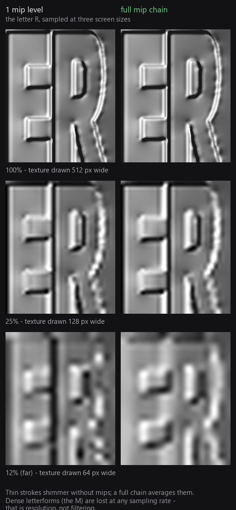
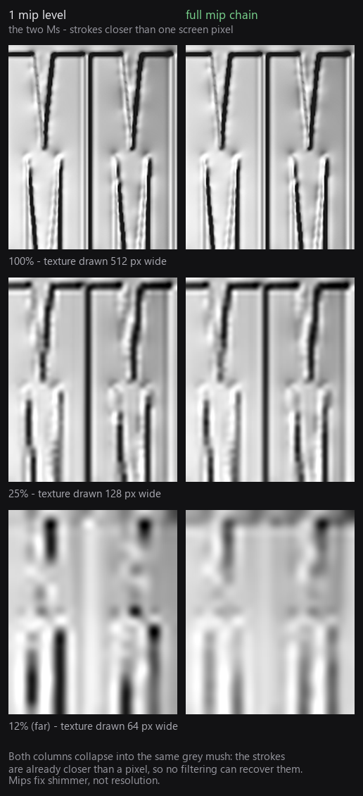
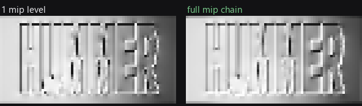

# Why mip levels matter

A texture in a game is never drawn at exactly its native size. When a badge is
far away it might cover 30 pixels on screen while the file is 512 pixels wide.
The GPU has to answer, 60 times a second: *which texels represent this surface
right now?*

A **mip chain** is the pre-computed answer. Each level is half the size of the
one before it:

```
512x256  256x128  128x64  64x32  32x16  16x8  8x4  4x2  2x1  1x1
  m0       m1       m2      m3     m4     m5    m6   m7   m8   m9
```

The hardware picks the level whose texel size is closest to one screen pixel and
samples that. A file with only level 0 has nothing to pick — so it keeps
sampling the full-size image at random texel positions, and the result changes
from frame to frame.

## What that looks like



At full size the two are identical. At 25% and below the single-level version keeps
raw high-frequency edges — the R's thin stroke breaks into bright steps that move
from frame to frame — while the chain settles on a stable shape.

That figure deliberately crops the letter R, because thin strokes are where the
difference lives. A dense letterform such as the M is a different story: its strokes
are closer together than one screen pixel at that distance, so it collapses into a
grey blob whether or not a chain exists. **That is a resolution limit, not a
filtering one** — mips cannot invent detail that the screen has no room for.



Both columns degrade the same way once the strokes fall below a pixel: the left one
boils, the right one goes soft, and neither reads as two Ms. If a badge has to stay
legible far away, the answer is fewer/simpler strokes or a bigger on-screen size,
not a better chain.

In motion it is worse than "noisy" — it *boils*:



This is why a badge that looks fine in the showroom shimmers the moment the
camera moves away from it.

## Which textures suffer most

| texture | what missing mips look like | severity |
| --- | --- | --- |
| normal maps | lighting jumps per frame, chrome surfaces sparkle | worst |
| alpha-tested detail (badges, foliage, fences) | edges crawl and disappear | high |
| spec / diffuse on paint and metal | boiling, moire | medium-high |
| flat interior colour | barely noticeable | low |
| UI / HUD | often *better* without mips | n/a |

## What it costs

Each level is a quarter of the previous one, so a full chain is about **+33%**
over level 0 alone.

| DXT1 512x256 | level 0 only | full chain |
| --- | --- | --- |
| bytes | 64 KB | 87.5 KB |

23 KB, once, in exchange for not shimmering at any distance. In practice every
texture a game ships with a full chain — a file with `mipLevels = 1` is a
mistake, not an optimisation.

## Two exceptions worth knowing

1. **Alpha cutouts.** Plain box filtering makes the alpha fade with every level,
   so leaves and thin lettering shrink and vanish in the distance. Those need
   coverage-preserving filtering (`texconv -keepcoverage`) rather than a naive
   downsample.
2. **Normal maps.** Averaging normals shortens them, so each generated level has
   to be re-normalised. Skip that and the surface looks flat and dark far away
   even though the chain exists.

## How to spot a file that needs fixing

For any texture, a full chain has

```
mipLevels == floor(log2(max(width, height))) + 1
```

A 512x256 texture should have 10 levels. A 648x324 texture should have 11. If
the count is 1, the texture was exported by a tool that does not write mips —
Photoshop's DDS exporter is the usual suspect.

## What `gtatools` does about it

- `gtatools normals` always emits a complete chain (`--max-mips` caps it).
- `gtatools scale` keeps the mip depth of the input and regenerates the levels
  for the new size.
- `gtatools pack` writes whatever the DDS file contains, so the fix has to
  happen at the DDS stage — which is exactly why the normal/retexture step owns
  it.
